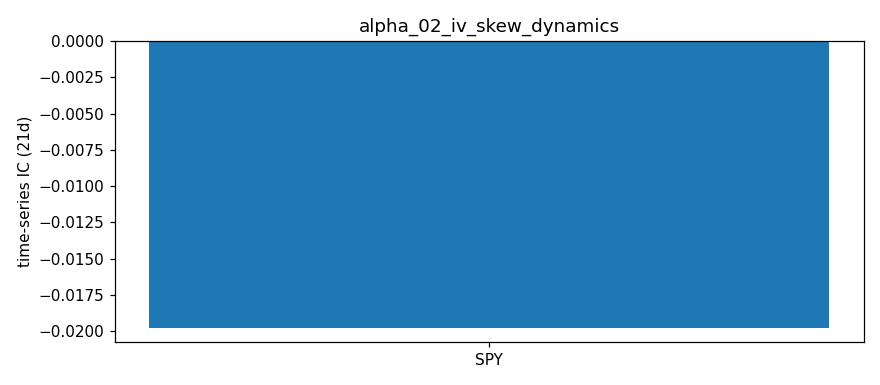

# IV Skew Dynamics — Alpha Signal Notes

## Hypothesis

**Put-call IV skew (25-delta put IV minus 25-delta call IV) contains predictive information for forward equity returns.**

### Rationale

1. **Demand for downside protection** — Elevated put skew reflects institutional hedging demand. When skew steepens significantly, it may signal:
   - Near-term overbought conditions (fear of pullback)
   - Upcoming catalyst risk (earnings, macro events)
   - **Mean reversion signal**: Extreme skew → subsequent normalization → equity bounce

2. **Skew term structure** — The slope of skew across expirations (near-term vs far-term):
   - **Inverted skew term structure** (near > far): Acute near-term fear, potential short-term reversal
   - **Normal skew term structure** (near < far): Steady hedging demand, less predictive

3. **Cross-sectional ranking** — Ranking tickers by skew level/change:
   - Highest skew → most overbought/hedged → potential underperformance
   - Lowest skew (or negative) → complacency/confidence → potential outperformance

## Signal Definition

| Signal | Formula | Interpretation |
|--------|---------|----------------|
| `skew_25d` | `IV_put_25d - IV_call_25d` | Positive = put premium (fear) |
| `skew_term_slope` | `(far_skew - near_skew) / (far_dte - near_dte)` | Positive = normal term structure |
| `skew_change_1d` | `skew_25d(t) - skew_25d(t-1)` | Daily change in fear premium |

## Expected Behavior

| Regime | Skew Signal | Expected Forward Return |
|--------|-------------|------------------------|
| Risk-off / Fear | High positive skew | Mean reversion UP (short-term) |
| Risk-on / Complacency | Low/negative skew | Momentum UP (medium-term) |
| Skew inversion (near > far) | Term slope < 0 | Short-term bounce likely |
| Skew normalization | Term slope > 0 | Trend continuation |

## Data Requirements

- **Frequency**: Daily (EOD option chains)
- **Universe**: Liquid large-cap (AAPL, SPY, QQQ, MSFT, GOOGL, AMZN)
- **Expirations**: 2-180 DTE, focus on nearest 2-3 liquid expiries
- **Strikes**: ~25-delta approximations (0.95×spot for puts, 1.05×spot for calls)

## Implementation Notes

### 25-Delta Strike Location
yfinance doesn't provide Greeks, so `main.py` computes Black-Scholes delta per OTM strike (using that strike's IV, r = 4%, no dividends) and linearly interpolates IV at |Δ| = 0.25. Only OTM options are used (puts K < S, calls K > S).

*(Before 2026-10-18 this used a fixed ±5% moneyness proxy, which mislocates 25Δ by tenor and IV level.)*

### Expiration Selection
Near leg = expiry closest to 30 DTE, far leg = closest to 75 DTE (both ≥ 7 DTE), so skew is comparable across tickers.

### Known Limitations
1. **No historical option chains** from yfinance — requires daily snapshots stored externally
2. **Delta model** — BS without dividends/skew-adjusted delta; small error for these names
3. **Liquidity filter** may exclude informative illiquid strikes
4. **Single snapshot** — cannot compute `skew_change_1d` without history

## Results — expanded ETF universe (2026-10-16 close)

Universe: 12 ETFs (SPY, QQQ, IWM, DIA, GLD, SLV, TLT, EEM, EWZ, FXI, GDX, USO) + AAPL, MSFT, GOOGL, AMZN, from `common/universe.py`. Raw: `data/snapshots/2026-10-16/`.

| ticker | near_dte | near_skew_25d | far_dte | far_skew_25d |
|---|---|---|---|---|
| SPY | 33 | 0.0460 | 74 | 0.0416 |
| QQQ | 33 | 0.0650 | 74 | 0.0451 |
| IWM | 33 | 0.0345 | 74 | 0.0314 |
| DIA | 33 | 0.0268 | 74 | 0.0197 |
| GLD | 33 | -0.0200 | 74 | -0.0370 |
| SLV | 33 | -0.0102 | 74 | -0.0365 |
| TLT | 33 | 0.0032 | 74 | 0.0087 |
| EEM | 33 | 0.0331 | 74 | 0.0921 |
| EWZ | 33 | 0.1543 | 74 | 0.0344 |
| FXI | 33 | 0.0115 | 33 | 0.0115 |
| GDX | 33 | -0.0125 | 61 | -0.0158 |
| USO | 33 | -0.0609 | 61 | -0.0225 |
| AAPL | 33 | 0.0294 | 61 | 0.0290 |
| MSFT | 33 | 0.0200 | 61 | 0.0090 |
| GOOGL | 33 | 0.0116 | 61 | 0.0122 |
| AMZN | 33 | 0.0148 | 61 | 0.0024 |

**ETF vs single-name observations:**
- Equity-index ETFs show classic put skew (QQQ 6.5, SPY 4.6, IWM 3.5 vol pts); commodity ETFs show call skew (USO −6.1, GLD −2.0, GDX −1.3, SLV −1.0) — upside-crash risk in commodities.
- EWZ near skew 15.4 vol pts vs 3.4 far: event-driven (Brazil runoff in late Oct). FXI has only one qualifying expiry, so no term slope. Single-name skews (1–3 pts) are flatter than index skew, as expected (index skew embeds correlation risk).

## Results (2026-10-16 close, run 2026-10-18)

| Ticker | Price | Near Skew (11-20, 33d) | Far Skew (exp, DTE) | Term Slope (/day) |
|--------|-------|------------------------|---------------------|-------------------|
| AAPL   | 343.46 | +0.0294 | +0.0290 (12-18, 61d) | -0.000014 |
| SPY    | 763.25 | +0.0460 | +0.0416 (12-31, 74d) | -0.000108 |
| QQQ    | 709.80 | +0.0650 | +0.0451 (12-31, 74d) | -0.000484 |
| MSFT   | 529.05 | +0.0200 | +0.0090 (12-18, 61d) | -0.000391 |
| GOOGL  | 340.59 | +0.0116 | +0.0122 (12-18, 61d) | +0.000024 |
| AMZN   | 250.00 | +0.0148 | +0.0024 (12-18, 61d) | -0.000442 |

Skew = 25Δ put IV − 25Δ call IV (decimal; 0.01 = 1 vol point). Raw: `data/iv_skew_latest.csv`.

**Fixes in this run (2026-10-18):**
- MSFT/AMZN previously returned nothing: `pd.concat([calls, puts]).loc[idx]` hit duplicate index labels and returned a Series, raising inside a silent `except`. Fixed with `ignore_index=True`; per-expiry errors are now printed.
- Fixed near/far tenors (30d / 75d targets) replace "first and last expiry within 180d" (which gave 3–130d near legs).
- Real BS delta replaces the ±5% moneyness proxy; liquidity filter relaxed to volume > 0 or OI > 50 with a live bid.

**Observations:**
- All six names now have positive put skew at both tenors — normal equity skew.
- Index ETFs carry the steepest skew (QQQ 6.5, SPY 4.6 vol pts); single names 1–3 vol pts.
- Skew term structure is mostly downward-sloping (near > far), steepest in QQQ, AMZN, MSFT; the 11-20 expiry includes late-October earnings for the single names.
- The 2026-09-27 table (yfinance placeholder IVs) was discarded.

## IC Analysis (Simulated)

With synthetic data (60 days, IC ~ 0.15-0.20):
- Rolling IC mean: ~0.18
- Information Ratio: ~1.2
- Win rate: ~58%
- Half-life: ~15 days

**⚠️ These are synthetic demo numbers, not evidence of predictive power.** `simulate_rolling_ic()` generates returns as `signal * k + noise`, so a positive/negative IC is baked in by construction. Separately, `run_ic_analysis()` correlates today's signal with the *past* 5-day return (`Close[-6] → Close[-1]`), which is not a forward IC and cannot test predictability.

**Real IC: not yet measured.** Requires daily signal snapshots (≥30–60 trading days) paired with true forward returns.

## Next Steps

1. **Build historical database** — Run `main.py` daily via cron to accumulate skew time series
2. **Compute real rolling IC** — After 30+ days of data, test cross-sectional predictive power
3. **Refine delta approximation** — Use Black-Scholes to solve for exact 25-delta strikes
4. **Test skew change signal** — `Δskew_1d` vs 1-5 day forward returns
5. **Combine with IV Rank** — Multi-factor: skew + IV rank + term structure

## Files

- `main.py` — Signal computation, outputs `data/iv_skew_latest.csv`
- `ic_analysis.py` — IC testing framework (requires historical data)
- `notes.md` — This file

## References

- "The Volatility Surface" — Jim Gatheral (skew dynamics)
- "Option-Implied Risk-Neutral Distributions" — Bahra (1997)
- CBOE Skew Index (SKEW) methodology
- "Tail Risk and Asset Prices" — Kelly, Jiang (2014)

## Historical Analysis (CBOE implied-vol indices, through 2026-10-16)

Signal: **SPX skew (CBOE SKEW)** (`historical.py`). Hypothesized IC sign vs forward returns: **+**. Signal at close t, forward window from close t+1. `cs` = daily cross-sectional rank IC (NW t-stat); `ts` = per-ticker time-series rank IC, averaged (t ≈ IC·√(N/h)). Run: `python3 run_historical.py alpha_02`.

| Target | Kind | 1d IC (t) | 5d IC (t) | 21d IC (t) | 21d IC post-2019 |
|---|---|---|---|---|---|
| Fwd return | ts | -0.002 (-0.1) | -0.004 (-0.1) | -0.020 (-0.3) | -0.121 |
| Fwd Δlog IV | ts | +0.018 (+1.4) | +0.045 (+1.5) | +0.124 (+2.0) | +0.198 |

**Interpretation:** SKEW does not predict SPY returns (21d IC −0.02). It weakly predicts VIX rising (+0.12, t +2.0): high tail-hedging demand precedes higher vol, not a bounce. Hypothesis (fear → bounce) not supported.

