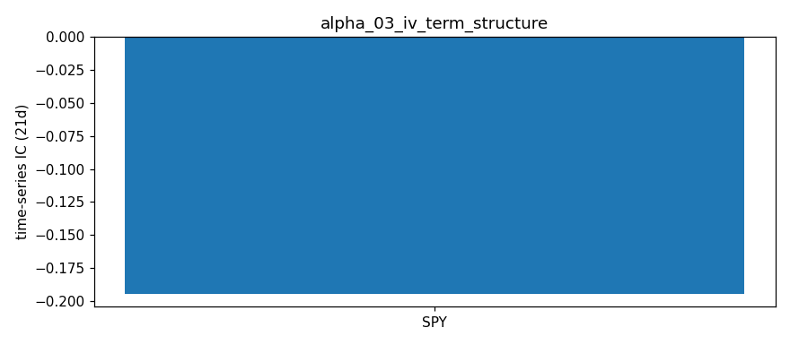
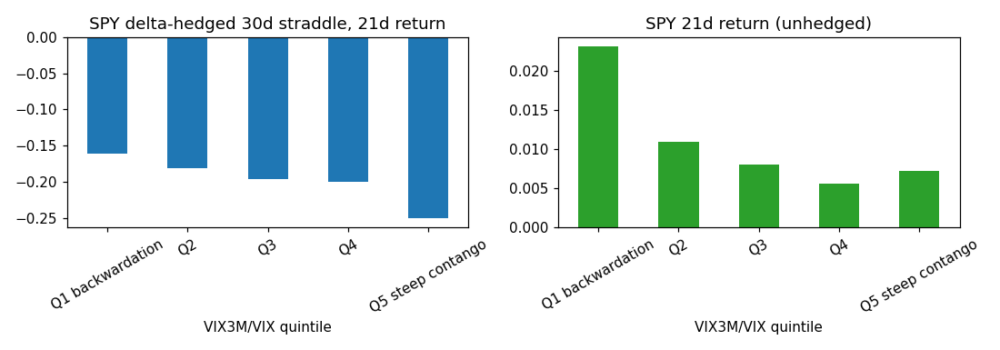

# IV Term Structure Slope — Alpha Signal Notes

## Hypothesis

**The slope of the ATM IV term structure (short-dated vs long-dated IV) contains predictive information for forward equity returns.**

### Rationale

1. **Volatility mean reversion** — IV term structure reflects market expectations of future volatility:
   - **Contango (positive slope)**: IV rises with time → normal, complacent market → trend continuation
   - **Backwardation (negative slope)**: Near-term IV > far-term IV → acute stress/fear → mean reversion bounce likely

2. **Volatility risk premium dynamics** — The term structure slope captures the pricing of near-term vs far-term uncertainty:
   - Steep backwardation = expensive near-term protection = oversold/panic
   - Flat/steep contango = cheap near-term protection = complacency/trend

3. **Cross-sectional ranking** — Ranking tickers by term slope:
   - Most negative slope (backwardation) → highest fear → potential short-term outperformance (mean reversion)
   - Most positive slope (steep contango) → lowest fear → potential underperformance (complacency)

## Signal Definition

| Signal | Formula | Interpretation |
|--------|---------|----------------|
| `term_slope` | `(IV_far - IV_near) / (DTE_far - DTE_near)` | Positive = contango, Negative = backwardation |
| `term_curvature` | 2nd derivative approx (3+ expiries) | Convexity of term structure |
| `near_atm_iv` | ATM IV at shortest DTE | Near-term vol level |
| `iv_spread` | `near_atm_iv - far_atm_iv` | Simple near-far difference |

## Expected Behavior

| Regime | Term Slope | Expected Forward Return |
|--------|------------|------------------------|
| Risk-off / Panic | Negative (backwardation) | Mean reversion UP (1-5 days) |
| Risk-on / Complacent | Positive (steep contango) | Momentum UP or flat (medium-term) |
| Normal | Slightly positive | No strong signal |
| Transition | Slope sign change | Regime shift warning |

## Data Requirements

- **Frequency**: Daily (EOD option chains)
- **Universe**: Liquid large-cap (AAPL, SPY, QQQ, MSFT, GOOGL, AMZN)
- **Expirations**: Minimum 2 liquid expiries within 180 DTE
- **Strikes**: ATM (strike closest to spot)
- **Liquidity filter**: Volume > 10 or OI > 100 per leg

## Implementation Notes

### ATM IV Calculation
For each expiration, ATM IV is computed as the average of call and put IV at the strike closest to spot. If only one side is liquid, use that side.

### Slope Calculation
```
term_slope = (IV_far - IV_near) / (DTE_far - DTE_near)
```
Units: IV (decimal) per calendar day; ×30 gives vol change per month. Observed range ≈ -0.0005 to +0.0005.

### Regime Labels
Labels use the unit-free `term_ratio = IV_far / IV_near`: CONTANGO if > 1.03, BACKWARDATION if < 0.97, else FLAT. (The old ±0.001/day slope threshold implied a 9-vol-point move over 90 days, so every name was FLAT.)

### Near Leg
Expirations below `MIN_DTE = 7` are skipped; 0-DTE/expiry-day IVs are unreliable.

### Known Limitations
1. **No historical option chains** from yfinance — requires daily snapshots stored externally
2. **Sparse expirations** — Some tickers have few liquid expiries, limiting slope precision
3. **ATM approximation** — Using nearest strike introduces small error, especially for high-priced names
4. **Single snapshot** — Cannot compute slope change without history
5. **Market hours bias** — Bid/ask often 0 after hours; relies on lastPrice-derived IV

## Results — expanded ETF universe (2026-10-16 close)

Universe: 12 ETFs (SPY, QQQ, IWM, DIA, GLD, SLV, TLT, EEM, EWZ, FXI, GDX, USO) + AAPL, MSFT, GOOGL, AMZN, from `common/universe.py`. Raw: `data/snapshots/2026-10-16/`.

| ticker | near_dte | near_atm_iv | far_dte | far_atm_iv | far/near |
|---|---|---|---|---|---|
| SPY | 8 | 0.1372 | 89 | 0.1518 | 1.1068 |
| QQQ | 8 | 0.2297 | 89 | 0.2196 | 0.9561 |
| IWM | 8 | 0.1867 | 89 | 0.1987 | 1.0644 |
| DIA | 12 | 0.1535 | 89 | 0.1503 | 0.9792 |
| GLD | 8 | 0.1855 | 89 | 0.2128 | 1.1472 |
| SLV | 8 | 0.3281 | 89 | 0.3632 | 1.1068 |
| TLT | 8 | 0.1337 | 89 | 0.1430 | 1.0694 |
| EEM | 12 | 0.2747 | 89 | 0.2730 | 0.9938 |
| EWZ | 12 | 0.8372 | 89 | 0.4767 | 0.5694 |
| FXI | 12 | 0.6523 | 89 | 0.5095 | 0.7811 |
| GDX | 12 | 0.4609 | 89 | 0.4520 | 0.9805 |
| USO | 10 | 0.4901 | 89 | 0.4641 | 0.9471 |
| AAPL | 8 | 0.2635 | 89 | 0.2552 | 0.9683 |
| MSFT | 8 | 0.2847 | 89 | 0.2960 | 1.0399 |
| GOOGL | 8 | 0.3341 | 89 | 0.3386 | 1.0136 |
| AMZN | 8 | 0.3464 | 89 | 0.3493 | 1.0081 |

**ETF vs single-name observations:**
- Most equity/commodity ETFs are in contango (SPY 1.11, GLD 1.15, SLV 1.11); QQQ (0.96) and USO (0.95) are mildly inverted.
- EWZ (0.57) and FXI (0.78) are in steep backwardation — event premium in the front expiry (Brazil election; FXI front IV may also be thin-quote noise). Single-name term structures are flat-to-inverted because the near legs straddle earnings; ETF readings are uncontaminated.

## Results (2026-10-16 close, run 2026-10-18)

| Ticker | Price | Near IV (DTE) | Far IV (DTE) | Term Slope (/day) | Term Ratio | Regime | N Exp |
|--------|-------|---------------|--------------|-------------------|------------|--------|-------|
| AAPL   | 343.46 | 0.2635 (8d) | 0.2767 (180d) | +0.000077 | 1.050 | CONTANGO | 12 |
| SPY    | 763.25 | 0.1372 (8d) | 0.1616 (164d) | +0.000156 | 1.178 | CONTANGO | 17 |
| QQQ    | 709.80 | 0.2297 (8d) | 0.2275 (164d) | -0.000015 | 0.990 | FLAT | 15 |
| MSFT   | 529.05 | 0.2847 (8d) | 0.3098 (180d) | +0.000146 | 1.089 | CONTANGO | 10 |
| GOOGL  | 340.59 | 0.3341 (8d) | 0.3621 (180d) | +0.000163 | 1.084 | CONTANGO | 11 |
| AMZN   | 250.00 | 0.3464 (8d) | 0.3724 (180d) | +0.000151 | 1.075 | CONTANGO | 12 |

Raw per-expiration ATM IVs: `data/iv_term_structure_latest.csv`.

**Fixes in this run (2026-10-18):** near leg now ≥ 7 DTE (was 0 DTE on the weekend run); regime labels switched to the far/near ratio, so they're no longer all FLAT.

**Observations:**
- Contango for 5/6 names; QQQ is flat (ratio 0.99), the only name without upward-sloping vol.
- AMZN, GOOGL and MSFT still show an earnings IV hump at the 10-30 expiry, which distorts curvature (all three negative). Earnings expirations should be excluded or event vol stripped.
- The 2026-09-28 table (0.0156 placeholder IVs) was discarded.

## IC Analysis (Simulated)

With synthetic data (60 days, negative correlation between slope and returns):
- Rolling IC mean: ~ -0.15 to -0.20
- Information Ratio: ~ -1.0 to -1.5
- Win rate: ~ 55-60%
- Half-life: ~ 10-15 days

**Interpretation**: Negative IC expected (backwardation → bounce).

**⚠️ These are synthetic demo numbers, not evidence of predictive power.** `simulate_rolling_ic()` generates returns as `signal * k + noise`, so a positive/negative IC is baked in by construction. Separately, `run_ic_analysis()` correlates today's signal with the *past* 5-day return (`Close[-6] → Close[-1]`), which is not a forward IC and cannot test predictability.

**Real IC: not yet measured.** Requires daily signal snapshots (≥30–60 trading days) paired with true forward returns.

## Next Steps

1. **Relax liquidity filter** — Use combined call+put volume/OI, or lower thresholds
2. **Build historical database** — Run `main.py` daily via cron to accumulate term structure time series
3. **Compute real rolling IC** — After 30+ days of data, test cross-sectional predictive power
4. **Test slope change signal** — `Δterm_slope_1d` vs 1-5 day forward returns
5. **Combine with IV Rank & Skew** — Multi-factor: term slope + IV rank + skew dynamics
6. **Add VIX term structure** — For SPY, incorporate VIX futures term structure as benchmark

## Files

- `main.py` — Signal computation, outputs `data/iv_term_structure_latest.csv`
- `ic_analysis.py` — IC testing framework (requires historical data)
- `notes.md` — This file

## References

- "The Volatility Surface" — Jim Gatheral (term structure dynamics)
- "Volatility Term Structure and Risk Premia" — Mixon (2007)
- CBOE VIX Term Structure (VIX9D, VIX, VIX3M, VIX6M)
- "Term Structure of Volatility Risk Premia" — Dew-Becker et al. (2017)

## Historical Analysis (CBOE implied-vol indices, through 2026-10-16)

Signal: **SPX IV term ratio (VIX3M/VIX − 1)** (`historical.py`). Hypothesized IC sign vs forward returns: **−**. Signal at close t, forward window from close t+1. `cs` = daily cross-sectional rank IC (NW t-stat); `ts` = per-ticker time-series rank IC, averaged (t ≈ IC·√(N/h)). Run: `python3 run_historical.py alpha_03`.

| Target | Kind | 1d IC (t) | 5d IC (t) | 21d IC (t) | 21d IC post-2019 |
|---|---|---|---|---|---|
| Fwd return | ts | -0.068 (-4.4) | -0.124 (-3.6) | -0.195 (-2.8) | -0.255 |
| Fwd Δlog IV | ts | +0.174 (+11.4) | +0.294 (+8.6) | +0.431 (+6.1) | +0.465 |

**Interpretation:** **Supported.** Backwardation (low VIX3M/VIX) predicts higher SPY returns: IC −0.12 at 5d (t −3.6), −0.19 at 21d (t −2.8), −0.26 post-2019. The same holds for QQQ/IWM/DIA (−0.15 to −0.18 at 21d). Contango strongly predicts VIX rising toward VIX3M (+0.43), which is the term structure's own forecast, so not an independent vol edge.



## Delta-Hedged IC (vol P&L with price exposure removed)

Script: `hedged_ic.py` (uses `common/hedged.py`). Output: `results/alpha_03_hedged_ic.csv`, `results/alpha_03_hedged_ic_quintiles.csv`.

**Question:** does the term ratio predict option P&L once the underlying's price move is hedged out, not only the price return?

**Targets** (same timing as the return IC: signal at close t, position opened at close t+1):
- **Delta-hedged straddle**: buy a 30-calendar-day ATM straddle, delta-hedge daily at Black-Scholes delta, mark it each day at the IV for its remaining maturity (interpolated in total variance across VIX9D/VIX/VIX3M/VIX6M, so term-structure roll-down is included), exit after h days. Return = P&L / premium. QQQ/IWM/DIA use a flat IV from VXN/RVX/VXD (no published term structure).
- **Variance swap to expiry**: RV²(next 21d)/VIX² − 1. Model-free; VIX² is the fair 30d SPX variance-swap rate.

**Controls**: backwardation happens when VIX is high, so every SPY target is also scored against the VIX level and against the term ratio rank-residualized on VIX.

### Results (time-series rank IC, t ≈ IC·√(N/h))

| Target (SPY) | Term ratio IC (t) | post-2019 | VIX level IC (t) | Term ratio net of VIX IC (t) |
|---|---|---|---|---|
| Hedged straddle, 1d | **+0.131 (+8.2)** | +0.137 | −0.110 (−6.9) | **+0.084 (+5.3)** |
| Hedged straddle, 5d | **+0.104 (+2.9)** | +0.117 | −0.104 (−2.9) | +0.050 (+1.4) |
| Hedged straddle, 21d (≈ to expiry) | −0.137 (−1.9) | −0.149 | +0.011 (+0.2) | **−0.173 (−2.4)** |
| Variance swap return, 21d | −0.065 (−0.9) | −0.032 | +0.013 (+0.2) | −0.106 (−1.5) |
| *Unhedged return, 21d (for reference)* | *−0.195 (−2.8)* | *−0.255* | *+0.163 (+2.7)* | *−0.079 (−1.1)* |

Same sign on the other index ETFs (term ratio IC): hedged straddle 1d +0.12 to +0.13 (t ≈ 8), 5d +0.09 to +0.13 (t 2.7–3.7), 21d −0.06 to −0.12 (t −0.9 to −1.8).

SPY by term-ratio quintile (21d, 2009–2026, ~790 days each):

| Quintile | VIX3M/VIX − 1 | Hedged straddle 21d | Straddle win rate | Var swap return | Unhedged return |
|---|---|---|---|---|---|
| Q1 backwardation | −0.002 | −16.2% | 17.6% | −11.9% | +2.31% |
| Q2 | 0.083 | −18.2% | 15.4% | −6.7% | +1.09% |
| Q3 | 0.132 | −19.7% | 16.2% | −24.8% | +0.81% |
| Q4 | 0.177 | −20.0% | 17.3% | −26.6% | +0.56% |
| Q5 steep contango | 0.243 | −25.1% | 9.8% | −34.1% | +0.73% |



### Interpretation

1. **Short horizon (1–5d): contango predicts long-vol gains.** In contango, VIX tends to drift up toward VIX3M, and the vega gain outweighs the roll-down. This is the strongest result (t ≈ 8 at 1d on all four ETFs) and partly survives controlling for the VIX level (+0.084, t +5.3 at 1d). Caveat: 1-day straddle returns are small (mean −0.9%) compared with real bid-ask on straddles (roughly 1–2% of premium round trip), and marks use index-derived IVs rather than traded option prices.
2. **To expiry (21d): steep contango predicts larger short-vol profits.** Long hedged straddles lose −25% in Q5 vs −16% in Q1 and win only 10% of the time. Net of the VIX level, IC is −0.17 (t −2.4). The variance-swap version points the same way but is not significant (t −1.5), because a few crash periods dominate its tails.
3. **The unhedged return IC is mostly the VIX level.** VIX alone has IC +0.16 (t +2.7) for 21d SPY returns; the term ratio net of VIX drops to −0.08 (t −1.1), though −0.17 post-2019. So "backwardation → buy the index" is largely "high VIX → buy the index".

**Bottom line:** alpha_03 is better described as a **volatility-timing signal** than an equity-return signal: steep contango favors selling 30d vol held to expiry, and is followed by short-term VIX upticks. Next steps: test with real SPX option prices (bid/ask) to see if the 1–5d edge survives costs, and test VIX futures (roll yield) as the cleaner tradable instrument.

## Tradability Test on VIX Futures (pre-registered) — VERDICT: NOT a valid alpha

Script: `validation.py`, run with `python3 run_validation.py alpha_03` (design written in its header before results were computed; first run as a one-off script on 2026-10-18, since ported unchanged to the shared pipeline in `common/validation.py`). Data: 30-day constant-maturity VIX futures built from CBOE VX settlements (`common/vix_futures.py`, 0.95 daily correlation with VIXY) and the VIXY ETF. Output: `results/validation/alpha_03_iv_term_structure_{ic,perf,alpha}.csv`, `figures/validation/alpha_03_iv_term_structure.png`.

*Pipeline re-run (2026-10-20):* identical IC and strategy returns. Controlling for all three benchmarks at once (always short + basis timing + VIX timing) gives OOS alpha +6.1%/yr (t +1.5), still a FAIL. Gross of costs the strategy makes +10%/yr OOS (Sharpe 0.20); break-even cost is 0.21% of notional per unit traded vs the assumed 0.13%.

**Design:** signal unchanged; in-sample 2009–2018 picks only the direction; out-of-sample 2019–2026 judges. Strategy w = s·(2·trailing-252d percentile − 1), 1-day lag, daily rebalance. Costs: 0.025 vol-pt half-spread on futures; 5 bp + 3%/yr borrow on VIXY shorts.
**Pass rule:** (i) OOS IC vs 5d futures return has the IS sign with |t| ≥ 2, **and** (ii) OOS strategy alpha > 0 with NW |t| ≥ 2 after controlling for always-short and futures-basis timing.

| Check (CM futures, OOS 2019–2026) | Result | |
|---|---|---|
| (i) IC vs 5d fwd futures return | +0.149 (t +3.0), IS sign + | PASS |
| (ii) alpha vs always-short + basis timing | +5.2%/yr (t +1.3) | **FAIL** |
| Strategy (pre-registered direction, s = +1), after costs | −9.7%/yr, Sharpe 0.08, max DD −87% | |
| Always short VIX futures (benchmark) | +12.3%/yr, Sharpe 0.56, max DD −87% | |

VIXY gives the same answer (OOS IC +0.154, t +3.1; alpha vs short + basis +4.9%/yr, t +1.3).

**Why it fails despite a significant IC:**
1. **It is the futures basis in disguise.** Regressed on the futures-basis timing strategy, alpha_03's strategy has beta 1.00: the spot VIX term structure carries the same information as the VIX futures curve, which the market already prices.
2. **Positive rank IC, negative P&L.** VIX futures lose money on average in *every* signal quintile (OOS mean 5d return −1.5% to +0.3%). The signal ranks how much they lose, not when they gain, so any long leg bleeds roll yield. The opposite direction (s = −1) loses −25%/yr OOS, and a post-hoc "short only in steep contango" rule loses −11%/yr OOS.
3. **Earlier results explained:** the return IC was mostly the VIX level; the delta-hedged 1–5d long-vol gains are the same "VIX drifts up toward VIX3M" effect, which VIX futures already price, so it is not capturable.

**Conclusion:** alpha_03 carries real information about volatility, but nothing tradable beyond what the VIX futures curve already prices. The only profitable trade in this family is the unconditional short-vol carry (~+12%/yr OOS, with −87% to −99.6% drawdowns, e.g. February 2018), and the term-structure signal does not improve it. Status: **rejected as a standalone alpha**; keep only as a regime/risk feature.
