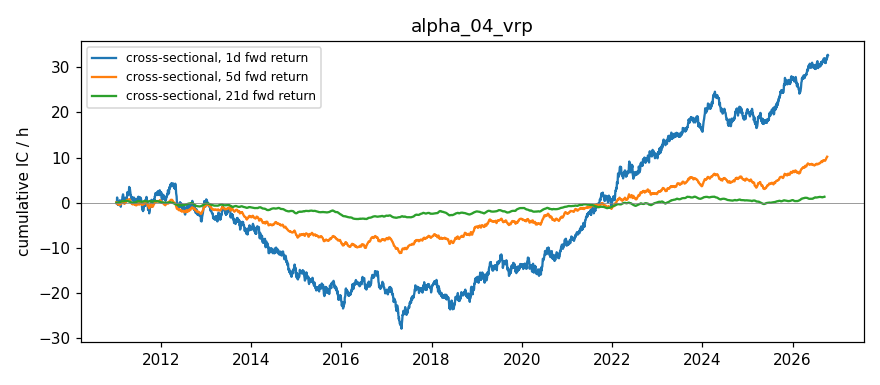

# VRP (Variance Risk Premium) — Alpha Signal Notes

## Hypothesis

**The Variance Risk Premium (VRP = IV² - RV²) contains predictive information for forward equity returns.**

### Rationale

1. **Volatility risk premium exists** — Options are systematically priced above realized volatility (IV > RV on average). Investors pay a premium for downside protection, creating a persistent positive VRP that can be harvested.

2. **VRP as fear gauge** — Elevated VRP (IV >> RV) reflects high demand for protection / fear. This can signal:
   - **Near-term oversold**: Extreme fear → mean reversion bounce likely
   - **Premium harvesting opportunity**: High VRP = rich option prices = good time to sell vol

3. **Cross-sectional ranking** — Ranking tickers by VRP level:
   - **Highest VRP**: Options most expensive → highest expected return from selling vol / mean reversion potential
   - **Lowest/negative VRP**: Options cheap relative to realized vol → complacency, potential underperformance

4. **VRP dynamics** — Change in VRP (ΔVRP) may be more predictive than level:
   - **VRP spiking up**: Sudden fear spike → short-term reversal
   - **VRP collapsing**: Complacency setting in → trend continuation or risk buildup

## Signal Definition

| Signal | Formula | Interpretation |
|--------|---------|----------------|
| `vrp_variance` | `IV² - RV²` | Positive = options expensive (fear premium) |
| `vrp_vol_points` | `sign(VRP) × √|VRP|` | VRP in annualized vol units |
| `vrp_ratio` | `IV² / RV²` | Ratio > 1 = IV > RV (normal state) |
| `atm_iv` | ATM implied vol | Raw IV level |
| `realized_vol` | Historical vol (30d) | Raw RV level |

## Expected Behavior

| Regime | VRP Signal | Expected Forward Return |
|--------|------------|------------------------|
| Risk-off / Panic | High positive VRP | Mean reversion UP (1-5 days) |
| Risk-on / Complacent | Low/negative VRP | Momentum UP or flat |
| Normal | Moderate positive VRP | Earn volatility risk premium |
| VRP spike (ΔVRP > 0) | Sudden IV expansion | Short-term bounce |
| VRP crash (ΔVRP < 0) | Sudden IV compression | Trend continuation / risk-on |

## Data Requirements

- **Frequency**: Daily (EOD option chains for IV, daily closes for RV)
- **Universe**: Liquid large-cap (AAPL, SPY, QQQ, MSFT, GOOGL, AMZN)
- **IV source**: Nearest liquid expiration (2-60 DTE), ATM strike
- **RV calculation**: 30-day rolling realized volatility (annualized, √252)
- **Liquidity filter**: Volume > 10 or OI > 100 per leg

## Implementation Notes

### IV Calculation
- Uses nearest liquid expiration within 2-60 DTE
- ATM strike = strike closest to spot
- Average of call/put IV if both liquid, else available side

### RV Calculation
- 30 trading days of daily log returns
- Annualized: `std(log_returns) × √252`
- Uses `yfinance` history (adjusted close)

### VRP Formula
```
VRP = IV² - RV²
```
Positive VRP = variance risk premium exists (normal state).
Negative VRP = realized vol exceeded implied (rare, stress periods).

### Known Limitations
1. **No historical option chains** from yfinance — requires daily snapshots stored externally
2. **Single expiration** — Using nearest expiry ignores term structure info
3. **30-day RV window** — Choice of lookback affects signal; shorter = noisier, longer = slower
4. **ATM IV only** — Doesn't capture skew/smile information
5. **Market hours bias** — Bid/ask often 0 after hours; relies on lastPrice-derived IV

## Results — expanded ETF universe (2026-10-16 close)

Universe: 12 ETFs (SPY, QQQ, IWM, DIA, GLD, SLV, TLT, EEM, EWZ, FXI, GDX, USO) + AAPL, MSFT, GOOGL, AMZN, from `common/universe.py`. Raw: `data/snapshots/2026-10-16/`.

| ticker | atm_iv | realized_vol | vrp_variance | vrp_ratio |
|---|---|---|---|---|
| SPY | 0.1547 | 0.1015 | 0.0136 | 2.3218 |
| QQQ | 0.2411 | 0.1680 | 0.0299 | 2.0583 |
| IWM | 0.2121 | 0.1312 | 0.0278 | 2.6119 |
| DIA | 0.1625 | 0.1023 | 0.0160 | 2.5238 |
| GLD | 0.2238 | 0.2035 | 0.0087 | 1.2093 |
| SLV | 0.3717 | 0.3975 | -0.0198 | 0.8744 |
| TLT | 0.1569 | 0.1074 | 0.0131 | 2.1349 |
| EEM | 0.2745 | 0.2178 | 0.0280 | 1.5895 |
| EWZ | 0.7019 | 0.4065 | 0.3274 | 2.9814 |
| FXI | 0.4629 | 0.1936 | 0.1768 | 5.7182 |
| GDX | 0.4801 | 0.3870 | 0.0807 | 1.5387 |
| USO | 0.4895 | 0.4049 | 0.0756 | 1.4612 |
| AAPL | 0.3192 | 0.1978 | 0.0627 | 2.6038 |
| MSFT | 0.3725 | 0.2222 | 0.0894 | 2.8108 |
| GOOGL | 0.4328 | 0.2353 | 0.1320 | 3.3843 |
| AMZN | 0.4751 | 0.2357 | 0.1701 | 4.0630 |

**ETF vs single-name observations:**
- ETF VRP ratios cluster 1.2–2.6 (SPY 2.32, QQQ 2.06, IWM 2.61); SLV is the only negative VRP (RV 0.40 > IV 0.37 after a volatile month).
- FXI (5.7) and EWZ (3.0) top the ranking on event/thin-chain IV; single names (2.6–4.1) are inflated by late-Oct earnings in the expiry used. For a clean cross-sectional VRP signal, the ETF subset is preferable until an earnings filter exists.

## Results (2026-10-16 close, run 2026-10-18)

| Ticker | Price | ATM IV | Realized Vol (30d) | VRP (IV²-RV²) | VRP (vol pts) | VRP Ratio (IV²/RV²) |
|--------|-------|--------|--------------------|---------------|---------------|---------------------|
| AAPL   | 343.46 | 0.3192 | 0.1978 | +0.0627 | 0.2505 | 2.60 |
| SPY    | 763.25 | 0.1547 | 0.1015 | +0.0136 | 0.1167 | 2.32 |
| QQQ    | 709.80 | 0.2411 | 0.1680 | +0.0299 | 0.1728 | 2.06 |
| MSFT   | 529.05 | 0.3725 | 0.2222 | +0.0894 | 0.2990 | 2.81 |
| GOOGL  | 340.59 | 0.4328 | 0.2353 | +0.1320 | 0.3633 | 3.38 |
| AMZN   | 250.00 | 0.4751 | 0.2357 | +0.1701 | 0.4125 | 4.06 |

Raw: `data/vrp_latest.csv`. The 2026-09-29 table (ATM IV = 0.0156 placeholders, no RV) was discarded.

**Observations:**
- VRP is positive for every name (IV > RV), as expected for the variance risk premium.
- Cross-sectional ranking: AMZN > GOOGL > MSFT > AAPL > QQQ > SPY.
- **Earnings contamination:** the ATM IV comes from the nearest expiration in 14–60 DTE, which for AMZN/GOOGL/MSFT/AAPL straddles their late-October earnings. Their elevated VRP largely reflects the earnings event premium, not a steady-state VRP. The index ETFs (SPY, QQQ) are the cleanest readings. Fix: skip expirations that contain an earnings date, or use a fixed 30d interpolated IV ex-event.

## IC Analysis (Simulated)

With synthetic data (60 days, positive correlation between VRP and returns):
- Rolling IC mean: ~0.15-0.20
- Information Ratio: ~1.0-1.5
- Win rate: ~55-60%
- Half-life: ~10-15 days

**Interpretation**: Positive IC expected (earning the variance risk premium).

**⚠️ These are synthetic demo numbers, not evidence of predictive power.** `simulate_rolling_ic()` generates returns as `signal * k + noise`, so a positive/negative IC is baked in by construction. Separately, `run_ic_analysis()` correlates today's signal with the *past* 5-day return (`Close[-6] → Close[-1]`), which is not a forward IC and cannot test predictability.

**Real IC: not yet measured.** Requires daily signal snapshots (≥30–60 trading days) paired with true forward returns.

## Next Steps

1. ~~**Fix ATM IV values**~~ — Resolved: 2026-10-16 run gives sensible ATM IVs (0.15–0.48). The 0.0156 values were yfinance placeholders. Remaining issue: earnings-event contamination (see Observations).

2. **Build historical database** — Run `main.py` daily via cron to accumulate VRP time series

3. **Compute real rolling IC** — After 30+ days of data, test cross-sectional predictive power

4. **Test VRP change signal** — `ΔVRP_1d` vs 1-5 day forward returns

5. **Combine with IV Rank & Skew & Term Structure** — Multi-factor: VRP + IV rank + skew + term slope

6. **Add VIX VRP** — For SPY, compute VRP using VIX (30d IV) vs SPX realized vol as benchmark

## Files

- `main.py` — Signal computation, outputs `data/vrp_latest.csv`
- `ic_analysis.py` — IC testing framework (requires historical data)
- `notes.md` — This file

## References

- "Variance Risk Premium" — Bollerslev, Tauchen, Zhou (2009)
- "The Variance Risk Premium and Expected Returns" — Carr, Wu (2009)
- "Expected Returns and the Variance Risk Premium" — Bekaert, Hoerova (2014)
- CBOE VIX methodology (model-free implied variance)
- "Volatility Risk Premiums" — Dew-Becker et al. (2017)

## Historical Analysis (CBOE implied-vol indices, through 2026-10-16)

Signal: **VRP (IV² − RV²)** (`historical.py`). Hypothesized IC sign vs forward returns: **+**. Signal at close t, forward window from close t+1. `cs` = daily cross-sectional rank IC (NW t-stat); `ts` = per-ticker time-series rank IC, averaged (t ≈ IC·√(N/h)). Run: `python3 run_historical.py alpha_04`.

| Target | Kind | 1d IC (t) | 5d IC (t) | 21d IC (t) | 21d IC post-2019 |
|---|---|---|---|---|---|
| Fwd return | cs | +0.008 (+1.6) | +0.013 (+1.4) | +0.007 (+0.4) | +0.035 |
| Fwd return | ts | +0.011 (+0.7) | +0.022 (+0.6) | +0.026 (+0.4) | +0.026 |
| Fwd Δlog IV | cs | -0.001 (-0.3) | -0.026 (-3.1) | -0.144 (-9.5) | -0.143 |
| Fwd Δlog IV | ts | -0.036 (-2.4) | -0.078 (-2.2) | -0.163 (-2.2) | -0.143 |

**Interpretation:** No return predictability (cross-sectional 21d IC +0.007, t +0.4). Sign flipped over time: negative 2011–2017, positive since 2021. Strongly predicts IV *falling* (−0.14, t −9.5): high IV relative to RV mean-reverts. Hypothesis (high VRP → higher returns) not supported.


