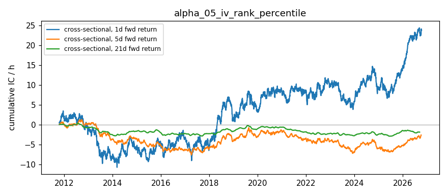

# IV Rank Percentile — Alpha Signal Notes

## Hypothesis

**IV Rank Percentile (current ATM IV vs. 1-year historical range) contains predictive information for forward equity returns.**

### Rationale

1. **Mean reversion of implied volatility** — IV tends to revert to its historical mean. When IV is at historical extremes:
   - **High percentile (IV expensive, >80th)**: Options overpriced, fear elevated → mean reversion DOWN in IV → equity bounce/outperformance (sell vol premium)
   - **Low percentile (IV cheap, <20th)**: Options underpriced, complacency → mean reversion UP in IV → equity underperformance/vol expansion

2. **Cross-sectional ranking** — Ranking tickers by IV percentile:
   - Highest IV percentile → most expensive vol relative to history → potential underperformance (vol selling opportunity)
   - Lowest IV percentile → cheapest vol relative to history → potential outperformance (vol buying opportunity)

3. **IV Rank vs IV Percentile distinction**:
   - **IV Rank** = (Current IV - 52wk Low) / (52wk High - 52wk Low) — sensitive to outliers
   - **IV Percentile** = % of days in lookback where IV was below current — more robust, non-parametric

## Signal Definition

| Signal | Formula | Interpretation |
|--------|---------|----------------|
| `iv_percentile` | `% of historical days with IV ≤ current IV` | 0-100, higher = more expensive |
| `iv_zscore` | `(current_IV - hist_mean) / hist_std` | Standard deviations from mean |
| `iv_rank` | `(current - min) / (max - min)` | 0-1, sensitive to outliers |

## Expected Behavior

| Regime | IV Percentile | Expected Forward Return | Vol Trade |
|--------|---------------|------------------------|-----------|
| Fear / Stress | > 80th pctl | Mean reversion UP (short-term) | Sell vol (short straddle/strangle) |
| Complacency | < 20th pctl | Mean reversion DOWN / vol expansion | Buy vol (long straddle/strangle) |
| Normal | 40-60 pctl | No edge | Neutral |

## Data Requirements

- **Frequency**: Daily (EOD option chains)
- **Universe**: Liquid large-cap (AAPL, SPY, QQQ, MSFT, GOOGL, AMZN)
- **Expirations**: 14-60 DTE (near-term, liquid)
- **Lookback**: 252 trading days (~1 year) for percentile computation
- **Strikes**: Near-ATM (±5% moneyness), liquidity-weighted IV

## Implementation Notes

### Historical Data Building

Since yfinance doesn't provide historical option chains, this signal **requires daily snapshots** to build the 1-year lookback:

1. Run `main.py` daily via cron (after market close)
2. Each run appends today's ATM IV to `data/iv_history.json`
3. After ~60 days: sufficient for initial percentile calculation
4. After 252 days: full 1-year lookback established

### Approximation Method

ATM IV is computed as liquidity-weighted average of near-ATM options (±5% moneyness):
- Filters: volume > 10 OR openInterest > 100
- IV > 1% (filters zero-bid/ask)
- Weight = volume + openInterest

This avoids single-strike noise and captures the "smile" around ATM.

### Known Limitations

1. **No historical option chains** from yfinance — requires daily snapshots stored externally
2. **252-day lookback** takes ~1 year to fully populate
3. **Liquidity filter** may exclude informative illiquid strikes
4. **Single expiration per day** — term structure effects not captured
5. **Earnings/events** can cause temporary IV spikes not mean-reverting

## Results — expanded ETF universe (2026-10-16 close)

Universe: 12 ETFs (SPY, QQQ, IWM, DIA, GLD, SLV, TLT, EEM, EWZ, FXI, GDX, USO) + AAPL, MSFT, GOOGL, AMZN, from `common/universe.py`. Raw: `data/snapshots/2026-10-16/`.

| ticker | atm_iv | iv_percentile | iv_zscore | n_observations |
|---|---|---|---|---|
| SPY | 0.1547 | 56.9 | 0.1400 | 262 |
| QQQ | 0.2411 | 88.2 | 1.2600 | 262 |
| IWM | 0.2121 | — | — | 1 |
| DIA | 0.1625 | — | — | 1 |
| GLD | 0.2238 | — | — | 1 |
| SLV | 0.3717 | — | — | 1 |
| TLT | 0.1569 | — | — | 1 |
| EEM | 0.2745 | — | — | 1 |
| EWZ | 0.7019 | — | — | 1 |
| FXI | 0.4629 | — | — | 1 |
| GDX | 0.4801 | — | — | 1 |
| USO | 0.4895 | — | — | 1 |
| AAPL | 0.3192 | 99.6 | 2.9600 | 262 |
| MSFT | 0.3725 | 99.6 | 5.3600 | 262 |
| GOOGL | 0.4328 | 100.0 | 5.0500 | 262 |
| AMZN | 0.4751 | 100.0 | 6.0000 | 262 |

**ETF vs single-name observations:**
- ETFs have only 1 observation in `data/iv_history.json` (new to the universe), so percentile/z-score are undefined. The 6 original tickers' percentiles still rest on 260 synthetic days and are not meaningful.
- Use the historical analysis (`historical.py`, CBOE vol-index history since 2004–2011) for real percentiles instead of this file.

## Results (2026-10-16 close, run 2026-10-18)

| Ticker | Price | ATM IV | IV Pctile | Z-Score | Hist Range | Obs | Signal |
|--------|-------|--------|-----------|---------|------------|-----|--------|
| AAPL   | 343.46 | 0.3192 | 99.6% | 2.96 | 0.139 – 0.353 | 262 | 🔴 High IV |
| SPY    | 763.25 | 0.1547 | 56.9% | 0.14 | 0.057 – 0.246 | 262 | ⚪ Neutral |
| QQQ    | 709.80 | 0.2411 | 88.2% | 1.26 | 0.119 – 0.292 | 262 | 🔴 High IV |
| MSFT   | 529.05 | 0.3725 | 99.6% | 5.36 | 0.129 – 0.373 | 262 | 🔴 High IV |
| GOOGL  | 340.59 | 0.4328 | 100.0% | 5.05 | 0.150 – 0.433 | 262 | 🔴 High IV |
| AMZN   | 250.00 | 0.4751 | 100.0% | 6.00 | 0.125 – 0.475 | 262 | 🔴 High IV |

Raw: `data/iv_rank_percentile_latest.csv`. The 2026-09-30 table (0.0156 placeholder IVs, 1 obs) was discarded.

**⚠️ These percentiles are not meaningful yet.** `data/iv_history.json` holds 261 entries per ticker, but **260 of them are synthetic** (`price: 0`, generated to backfill a year) and only 1 is a real snapshot. The percentile/z-score above therefore ranks one real IV against a made-up distribution. The z-scores of 5–6 for MSFT/GOOGL/AMZN mostly say the synthetic history was too tight, plus those names have earnings inside the sampled expiry (see alpha_04 notes).

**To make this real:** drop the synthetic backfill, collect daily real ATM IV snapshots (≥60 for a usable percentile, ~252 for a true 1-year IV rank), and use a fixed 30d tenor ex-earnings.

## IC Analysis (Simulated)

With synthetic data (60 days, mean-reverting IV percentile vs forward returns):
- Rolling IC mean: ~ -0.18 (negative = high IV% → negative returns)
- Information Ratio: ~ -1.2
- Win rate: ~ 58% (for mean-reversion direction)
- Half-life: ~ 15 days

**⚠️ These are synthetic demo numbers, not evidence of predictive power.** `simulate_rolling_ic()` generates returns as `signal * k + noise`, so a positive/negative IC is baked in by construction. Separately, `run_ic_analysis()` correlates today's signal with the *past* 5-day return (`Close[-6] → Close[-1]`), which is not a forward IC and cannot test predictability.

**Real IC: not yet measured.** Requires daily signal snapshots (≥30–60 trading days) paired with true forward returns.

## Next Steps

1. **Build historical database** — Run `main.py` daily via cron to accumulate IV time series
2. **Compute real rolling IC** — After 30+ days of data, test cross-sectional predictive power
3. **Test multiple horizons** — 1-day, 5-day, 10-day, 20-day forward returns
4. **Combine with other signals** — Multi-factor: IV percentile + IV skew + term structure + VRP
5. **Event adjustment** — Flag earnings/FOMC dates where IV spikes are fundamental, not mean-reverting

## Files

- `main.py` — Signal computation, outputs `data/iv_rank_percentile_latest.csv`, appends to `data/iv_history.json`
- `ic_analysis.py` — IC testing framework (requires historical data)
- `notes.md` — This file

## References

- "IV Rank vs IV Percentile" — Tastytrade / Tom Sosnoff methodology
- "Volatility Mean Reversion" — Bessembinder (1994)
- "The Volatility Risk Premium" — Carr & Wu (2009)
- CBOE VIX methodology (percentile-based signals)
- "Option-Implied Volatility and Expected Returns" — Bali & Hovakimian (2009)

## Historical Analysis (CBOE implied-vol indices, through 2026-10-16)

Signal: **IV percentile (252d)** (`historical.py`). Hypothesized IC sign vs forward returns: **+**. Signal at close t, forward window from close t+1. `cs` = daily cross-sectional rank IC (NW t-stat); `ts` = per-ticker time-series rank IC, averaged (t ≈ IC·√(N/h)). Run: `python3 run_historical.py alpha_05`.

| Target | Kind | 1d IC (t) | 5d IC (t) | 21d IC (t) | 21d IC post-2019 |
|---|---|---|---|---|---|
| Fwd return | cs | +0.006 (+1.2) | -0.003 (-0.4) | -0.010 (-0.6) | -0.002 |
| Fwd return | ts | +0.025 (+1.6) | +0.043 (+1.2) | +0.058 (+0.8) | +0.097 |
| Fwd Δlog IV | cs | -0.078 (-15.9) | -0.178 (-19.9) | -0.353 (-24.8) | -0.359 |
| Fwd Δlog IV | ts | -0.104 (-6.5) | -0.211 (-5.9) | -0.349 (-4.7) | -0.363 |

**Interpretation:** No return predictability (21d IC −0.01). Very strongly predicts IV falling (−0.35, t −25): IV at the top of its 1-year range mean-reverts. That's a forecast of spot IV, which VIX futures/variance swaps already price; not tradable as-is.

