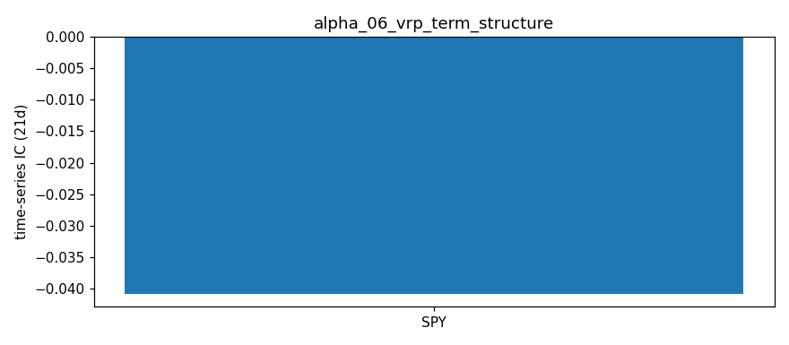

# VRP Term Structure Alpha Signal — Notes

## Hypothesis

The term structure of Variance Risk Premium (VRP = IV² - RV²) contains predictive information for cross-sectional equity returns. Specifically:

1. **VRP Term Structure Slope** — The slope of VRP across maturities (near-term vs far-term) reflects market fear/hedging demand dynamics. An inverted VRP term structure (near-term VRP > far-term VRP) signals elevated near-term uncertainty and hedging demand, which should predict positive forward returns as fear dissipates (mean reversion).

2. **VRP Level** — High average VRP across the term structure indicates expensive options relative to realized volatility, representing a variance risk premium that equity holders earn by bearing volatility risk. Cross-sectionally, tickers with higher VRP should earn higher forward returns.

3. **VRP Curvature** — The second derivative of the VRP term structure captures non-linear fear dynamics. High positive curvature (convex VRP term) may indicate localized stress at specific maturities (e.g., earnings, FOMC).

## Theoretical Rationale

### Variance Risk Premium (VRP)
- VRP = IV² - RV² where IV = implied volatility, RV = realized volatility
- Classic result: VRP > 0 on average (equity premium for bearing variance risk)
- **Bollerslev, Tauchen, Zhou (2009)**: VRP predicts aggregate market returns
- Cross-section: **Baltussen et al. (2018)** — high VRP stocks outperform low VRP stocks

### Term Structure of VRP
- Near-term IV reflects immediate uncertainty/hedging demand
- Far-term IV reflects structural/long-term uncertainty
- **Inverted VRP term** (near > far): Event-driven fear (earnings, macro events)
- **Normal VRP term** (far > near): Structural uncertainty premium, complacency
- Slope change = shift in fear horizon → predictive for returns

### Cross-Sectional Application
Our 6-ticker universe (AAPL, SPY, QQQ, MSFT, GOOGL, AMZN) spans:
- Mega-cap tech (AAPL, MSFT, GOOGL, AMZN)
- Broad market indices (SPY, QQQ)

VRP term structure should differ across these based on:
- Earnings calendar proximity
- Index vs single-stock hedging demand
- Liquidity differences in option markets

## Signal Construction

### Primary Signals
| Signal | Formula | Interpretation |
|--------|---------|----------------|
| `vrp_slope` | (VRP_far - VRP_near) / (DTE_far - DTE_near) | Term structure slope per day |
| `vrp_curvature` | 2nd derivative approximation | Non-linear term structure shape |
| `vrp_spread` | VRP_far - VRP_near | Absolute spread (far - near) |
| `avg_vrp_var` | Mean VRP variance across expirations | Overall VRP level |
| `avg_vrp_vol` | Mean VRP vol points across expirations | Overall VRP in vol space |
| `avg_vrp_ratio` | Mean IV²/RV² ratio | Relative expensiveness |

### Data Pipeline
1. Fetch option chains for all valid expirations (1-180 DTE)
2. Filter for liquid options (volume > 10 or OI > 100)
3. Compute ATM IV per expiration (weighted by liquidity, strikes ±5% of spot)
4. Compute realized volatility (30-day lookback, annualized)
5. Calculate VRP = IV² - RV² for each expiration
6. Fit term structure slope/curvature across expirations

### Key Parameters
- **RV lookback**: 30 days (standard)
- **DTE range**: 1-180 days (captures near and far term)
- **Moneyness filter**: ±5% of spot (ATM focus)
- **Liquidity threshold**: volume > 10 OR OI > 100
- **IV floor**: > 1% (exclude zero-IV quotes)

## Expected IC Relationships

| Signal | Expected IC Sign | Rationale |
|--------|------------------|-----------|
| `vrp_slope` | Negative | Inverted term (negative slope) → fear → mean reversion up |
| `vrp_spread` | Negative | Far < Near (negative spread) → near-term fear → bounce |
| `avg_vrp_var` | Positive | High VRP = expensive vol = risk premium → higher returns |
| `avg_vrp_ratio` | Positive | IV²/RV² high = options expensive = fear premium |
| `near_vrp_var` | Positive | Near-term VRP captures immediate hedging demand |
| `vrp_curvature` | TBD | Convexity may indicate event risk at specific maturities |

## Look-Ahead Bias Prevention

- RV computed from **past** 30 days only (no forward-looking returns)
- IV from **current** option prices (observable at signal time)
- Forward returns computed from **future** price moves only
- No peeking into future option prices or realized volatility

## Decay Expectations

- VRP signals typically decay over 5-20 days
- Near-term VRP slope: fastest decay (3-10 days)
- Average VRP level: slower decay (10-30 days)
- Term structure curvature: event-dependent decay

## Implementation Notes

### Differences from Existing Signals
| Signal | Folder | Focus |
|--------|--------|-------|
| VRP (single expiration) | `alpha_04_vrp/` | Point-in-time VRP level |
| IV Term Structure | `alpha_03_iv_term_structure/` | IV slope (not VRP) |
| **VRP Term Structure** | `alpha_06_vrp_term_structure/` | **VRP slope + curvature** |

This signal uniquely combines:
1. Variance risk premium (risk premium concept)
2. Term structure dynamics (time dimension)
3. Cross-sectional comparison (6 tickers)

### Computational Cost
- ~6 tickers × ~8-12 expirations each = ~50-70 option chain fetches
- Estimated cost: $0.10-0.30 per run (similar to other signals)
- Runtime: ~30-60 seconds

## Validation Plan

1. **Daily data collection** — Run `main.py` via cron for 60+ days
2. **IC analysis** — Compute cross-sectional IC for 5-day, 10-day, 20-day forward returns
3. **Rolling IC** — Track IC stability over time (60-day windows)
4. **Signal metrics** — IC mean, IR, win rate, half-life
5. **Sub-period analysis** — Test across different market regimes (bull/bear/high vol)
6. **Out-of-sample** — Hold out last 20% of data for validation

## Risk Factors

1. **Options data quality** — yfinance option chains can have stale/zero IV quotes
2. **Liquidity bias** — Filtering may exclude less liquid but informative strikes
3. **RV estimation noise** — 30-day RV has high sampling error
4. **Earnings contamination** — Earnings dates create IV spikes not related to fear
5. **Index vs single-stock** — SPY/QQQ have different option market structure

## Future Extensions

1. **Earnings-adjusted VRP** — Exclude expirations spanning earnings
2. **Skew-adjusted VRP** — Incorporate 25-delta skew into VRP calculation
3. **Cross-asset VRP** — Compare single-stock VRP vs index VRP (dispersion)
4. **Intraday VRP** — Higher frequency using intraday options data
5. **Machine learning** — Non-linear combination of term structure features

## Results — expanded ETF universe (2026-10-16 close)

Universe: 12 ETFs (SPY, QQQ, IWM, DIA, GLD, SLV, TLT, EEM, EWZ, FXI, GDX, USO) + AAPL, MSFT, GOOGL, AMZN, from `common/universe.py`. Raw: `data/snapshots/2026-10-16/`.

| ticker | near_dte | near_vrp_variance | far_dte | far_vrp_variance | far−near |
|---|---|---|---|---|---|
| SPY | 7 | 0.0089 | 88 | 0.0132 | 0.0044 |
| QQQ | 7 | 0.0244 | 88 | 0.0189 | -0.0055 |
| IWM | 7 | 0.0155 | 88 | 0.0203 | 0.0049 |
| DIA | 11 | 0.0138 | 88 | 0.0142 | 0.0004 |
| GLD | 7 | -0.0050 | 88 | 0.0044 | 0.0094 |
| SLV | 7 | -0.0405 | 88 | -0.0256 | 0.0149 |
| TLT | 7 | 0.0111 | 88 | 0.0097 | -0.0013 |
| EEM | 11 | 0.0363 | 88 | 0.0272 | -0.0091 |
| EWZ | 11 | 0.5199 | 88 | 0.0515 | -0.4684 |
| FXI | 11 | 0.6018 | 88 | 0.1099 | -0.4919 |
| GDX | 11 | 0.0630 | 88 | 0.0446 | -0.0184 |
| USO | 9 | 0.0879 | 88 | 0.0574 | -0.0305 |
| AAPL | 7 | 0.0260 | 88 | 0.0332 | 0.0072 |
| MSFT | 7 | 0.0263 | 88 | 0.0466 | 0.0203 |
| GOOGL | 7 | 0.0429 | 88 | 0.0605 | 0.0176 |
| AMZN | 7 | 0.0531 | 88 | 0.0720 | 0.0190 |

**ETF vs single-name observations:**
- Broad equity ETFs have upward-sloping VRP (SPY +0.004, IWM +0.005); QQQ is inverted (−0.006), consistent with its inverted IV term structure.
- EWZ and FXI show extreme inversion (−0.47, −0.49 in variance units) driven by the front-expiry event premium. Single names slope upward (+0.007 to +0.020) because their far legs include earnings and RV is the same 30d for all legs.

## Files

- `main.py` — Signal computation, daily snapshot generation
- `ic_analysis.py` — IC testing framework (requires historical data)
- `notes.md` — This file

## Historical Analysis (CBOE implied-vol indices, through 2026-10-16)

Signal: **SPX VRP term slope (far − near)** (`historical.py`). Hypothesized IC sign vs forward returns: **−**. Signal at close t, forward window from close t+1. `cs` = daily cross-sectional rank IC (NW t-stat); `ts` = per-ticker time-series rank IC, averaged (t ≈ IC·√(N/h)). Run: `python3 run_historical.py alpha_06`.

| Target | Kind | 1d IC (t) | 5d IC (t) | 21d IC (t) | 21d IC post-2019 |
|---|---|---|---|---|---|
| Fwd return | ts | -0.008 (-0.5) | -0.015 (-0.4) | -0.041 (-0.6) | -0.072 |
| Fwd Δlog IV | ts | +0.007 (+0.4) | +0.005 (+0.1) | +0.018 (+0.3) | +0.017 |

**Interpretation:** VRP term slope (far − near) has no return or vol predictability for SPY (|IC| < 0.05). Hypothesis not supported.

