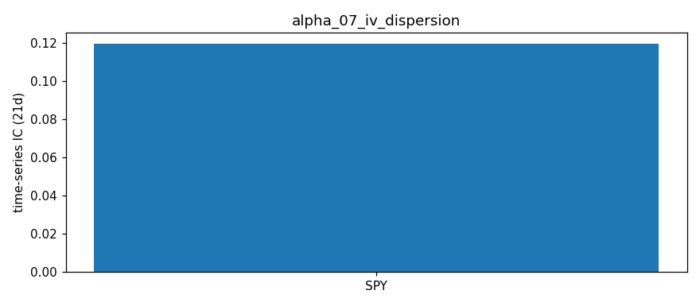

# IV Dispersion (Index vs Constituent) — Alpha Signal Notes

## Hypothesis

**Index options are systematically mispriced relative to their constituents.**

- Index IV (SPY/QQQ) reflects aggregate hedging demand (institutional portfolio insurance)
- Constituent IVs (AAPL, MSFT, GOOGL, AMZN) reflect single-stock supply/demand
- When index IV > weighted constituent IV → index options expensive (fear premium)
- When index IV < weighted constituent IV → index options cheap (complacency)

**Signal**: `Dispersion = Index_ATM_IV - Weighted_Constituent_ATM_IV`

## Why It Should Work

1. **Structural hedging demand**: Institutions buy index puts for portfolio protection, creating persistent bid in index options
2. **Dealer gamma hedging**: Market makers delta-hedge index options, creating mean-reversion pressure
3. **Correlation risk premium**: Index IV embeds correlation risk; constituents don't. When correlation spikes, index IV spikes more
4. **Mean reversion**: Dispersion oscillates around structural equilibrium (typically slightly positive due to hedging demand)

## Expected Decay

- **Horizon**: 5-20 days (index vol mean-reverts faster than single-stock)
- **IC Target**: |IC| > 0.05 for 5-day forward returns
- **Turnover**: Low — dispersion changes slowly (driven by IV levels, not prices)

## Implementation Details

### Weights
Uses approximate top-4 holdings weights:
- **SPY**: AAPL 7%, MSFT 6%, GOOGL 3.5%, AMZN 3.5% (sum = 20% of SPY)
- **QQQ**: AAPL 12%, MSFT 10%, GOOGL 6%, AMZN 5% (sum = 33% of QQQ)

Weights normalized to available constituents each run.

### Data Requirements
- ATM IV for 14-60 DTE expiration (same as alpha_04, alpha_05)
- Daily snapshots to build history for IC analysis
- ~$0.10-0.30 per run (6 tickers × 2 option chains)

### Outputs
- `data/iv_dispersion_latest.csv` — current snapshot
- `data/iv_dispersion_history.json` — persistent history for IC analysis

## Risk Factors / Look-Ahead Checks

✅ **No look-ahead**: Uses only current option chains (available at market close)
✅ **Forward returns**: IC analysis uses 5-day forward returns only
⚠️ **Weights drift**: SPY/QQQ weights change quarterly; should update periodically
⚠️ **Constituent coverage**: Only top 4 names — misses 80%/67% of index weight
⚠️ **Liquidity bias**: Only uses liquid strikes; may miss OTM skew information

## Integration with Other Signals

| Signal | Relationship |
|--------|--------------|
| **alpha_04 VRP** | Dispersion + VRP = index fear vs single-stock fear |
| **alpha_02 Skew** | High put skew + high dispersion = strong hedging demand |
| **alpha_03 Term Structure** | Backwardation + dispersion = near-term panic |
| **alpha_05 IV Percentile** | High percentile + high dispersion = extreme signal |

## Trading Logic (Conceptual)

```
if dispersion > 2% (200 bps):
    → Sell index straddle / Buy constituent straddles (dispersion trade)
elif dispersion < -2%:
    → Buy index straddle / Sell constituent straddles
else:
    → Neutral
```

## Results — expanded ETF universe (2026-10-16 close)

Universe: 12 ETFs (SPY, QQQ, IWM, DIA, GLD, SLV, TLT, EEM, EWZ, FXI, GDX, USO) + AAPL, MSFT, GOOGL, AMZN, from `common/universe.py`. Raw: `data/snapshots/2026-10-16/`.

| index | index_atm_iv | weighted_const_iv | dispersion | dispersion_ratio | n_constituents |
|---|---|---|---|---|---|
| SPY | 0.1547 | 0.3823 | -0.2277 | 0.4046 | 4 |
| QQQ | 0.2411 | 0.3796 | -0.1386 | 0.6350 | 4 |

**ETF vs single-name observations:**
- Dispersion is only defined for SPY and QQQ (top-4 holdings: AAPL, MSFT, GOOGL, AMZN). Other ETFs have no small liquid constituent set, so the universe expansion does not apply here.
- Constituent IV (0.38) is far above index IV (SPY 0.15, QQQ 0.24): implied correlation is low, but the constituent IVs are inflated by late-Oct earnings, so the ratio overstates dispersion today.

## IC Analysis

Run `ic_analysis.py` after building 20+ days of history:
- Computes Spearman rank IC between dispersion and 5-day forward index returns
- Tracks IR, win rate, max/min IC
- Requires `data/iv_dispersion_history.json` populated by daily `main.py` runs

## Next Steps

1. [ ] Run daily for 30+ days to build history
2. [ ] Compute IC and validate predictive power
3. [ ] Add rolling weights from actual SPY/QQQ holdings (via ETF fact sheets)
4. [ ] Test dispersion + VRP combo signal
5. [ ] Add constituent correlation regime detection

## Historical Analysis (CBOE implied-vol indices, through 2026-10-16)

Signal: **SPX implied correlation (COR3M)** (`historical.py`). Hypothesized IC sign vs forward returns: **+**. Signal at close t, forward window from close t+1. `cs` = daily cross-sectional rank IC (NW t-stat); `ts` = per-ticker time-series rank IC, averaged (t ≈ IC·√(N/h)). Run: `python3 run_historical.py alpha_07`.

| Target | Kind | 1d IC (t) | 5d IC (t) | 21d IC (t) | 21d IC post-2019 |
|---|---|---|---|---|---|
| Fwd return | ts | +0.026 (+1.9) | +0.066 (+2.1) | +0.119 (+1.9) | +0.213 |
| Fwd Δlog IV | ts | -0.069 (-5.0) | -0.133 (-4.3) | -0.252 (-4.0) | -0.295 |

**Interpretation:** Borderline. High implied correlation (COR3M) precedes higher index returns: +0.07 at 5d (t ≈ 2 for SPY/QQQ/IWM/DIA), +0.12 at 21d (t +1.9), +0.21 post-2019. Also predicts VIX falling (−0.25, t −4.0). Worth keeping; needs out-of-sample confirmation.


