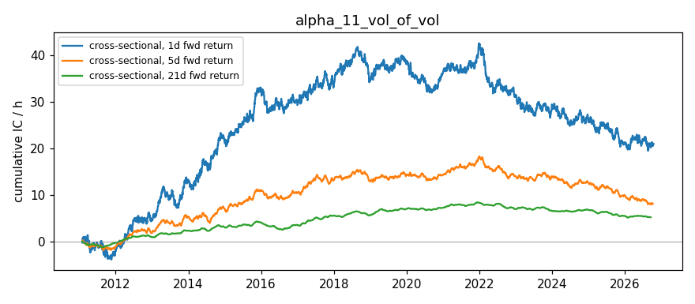

# Vol-of-Vol (Volatility of Volatility) — Alpha Signal Notes

## Hypothesis

**The realized volatility of ATM implied volatility (Vol-of-Vol) contains predictive information for forward equity returns and vol regime changes.**

### Rationale

1. **Vol-of-Vol measures regime stability** — Low VoV = stable vol regime where mean-reversion strategies work; High VoV = unstable regime with elevated tail risk and regime transition probability.

2. **VoV as uncertainty gauge** — Rising VoV reflects increasing disagreement about fair volatility, often preceding:
   - **Earnings/events**: IV expansion uncertainty
   - **Macro shocks**: Fed decisions, CPI prints, geopolitical events
   - **Regime transitions**: Calm → storm or storm → calm

3. **Cross-sectional ranking** — Ranking tickers by VoV level:
   - **Highest VoV**: Most unstable vol regime → highest regime transition risk, potential for large moves (direction uncertain)
   - **Lowest VoV**: Most stable vol regime → favorable for mean-reversion, vol-selling strategies
   - **Rising VoV (ΔVoV > 0)**: Uncertainty increasing → reduce position size, hedge tail risk
   - **Falling VoV (ΔVoV < 0)**: Uncertainty decreasing → mean-reversion opportunity emerging

4. **VoV predicts vol regime changes** — High VoV should predict rising realized vol (vol clustering), while low VoV predicts vol compression.

## Signal Definition

| Signal | Formula | Interpretation |
|--------|---------|----------------|
| `vol_of_vol` | `std(d(IV)/IV)` rolling 20d × √252 | Annualized vol of IV returns; higher = more unstable |
| `vol_of_vol_change` | `VoV_t - VoV_{t-1}` | 1-day change in VoV; positive = rising instability |
| `vov_percentile` | Cross-sectional rank of VoV | Relative instability vs peers (1.0 = most unstable) |
| `atm_iv` | ATM implied vol (current) | Current IV level for context |
| `iv_change_1d` | 1-day IV return | Direction of IV move |

## Expected Behavior

| Regime | VoV Signal | Expected Forward Return | Expected Vol Change |
|--------|------------|------------------------|---------------------|
| Calm / Stable | Low VoV (<0.2) | Mean-reversion works | Vol compression |
| Normal | Medium VoV (0.2-0.4) | Slight negative (vol drag) | Stable |
| Uncertain / Pre-event | Rising VoV | Negative (risk-off) | Vol expansion |
| Crisis / Stress | High VoV (>0.5) | Mean reversion bounce likely | Peak vol, then compression |
| Post-crisis | Falling VoV | Positive (recovery) | Vol compression |

## Data Requirements

- **Frequency**: Daily (EOD option chains for ATM IV)
- **Universe**: Liquid large-cap (AAPL, SPY, QQQ, MSFT, GOOGL, AMZN)
- **IV source**: Nearest liquid expiration (14-60 DTE), ATM strike (±5% moneyness)
- **VoV calculation**: 20-day rolling std of daily IV log-returns, annualized (√252)
- **Liquidity filter**: Volume > 10 or OI > 100 per leg
- **History building**: Requires daily snapshots stored in `data/vol_of_vol_history.csv`

## Implementation Notes

### ATM IV Calculation
- Uses nearest liquid expiration within 14-60 DTE
- ATM strike = weighted average by liquidity (volume + OI) of options within ±5% of spot
- Filters: IV > 0.01, liquid options only

### VoV Calculation
```python
# Daily IV returns
iv_returns = iv_series.pct_change()

# Rolling std (20-day) annualized
vol_of_vol = iv_returns.rolling(20).std() * sqrt(252)
```

### Known Limitations
1. **No historical option chains** from yfinance — requires daily snapshots stored externally (built by running `main.py` daily)
2. **Single expiration** — Using nearest expiry ignores term structure of VoV
3. **20-day window** — Choice of lookback affects signal; shorter = noisier, longer = slower
4. **ATM IV only** — Doesn't capture skew/smile VoV (could extend to 25-delta VoV)
5. **Market hours bias** — Bid/ask often 0 after hours; relies on lastPrice-derived IV
6. **Cross-sectional only 6 tickers** — Small universe limits statistical power for IC

## Results — expanded ETF universe (2026-10-16 close)

Universe: 12 ETFs (SPY, QQQ, IWM, DIA, GLD, SLV, TLT, EEM, EWZ, FXI, GDX, USO) + AAPL, MSFT, GOOGL, AMZN, from `common/universe.py`. Raw: `data/snapshots/2026-10-16/`.

**ETF vs single-name observations:**
- Expanded universe adds 12 ETFs, but vol-of-vol still needs 20 days of ATM IV history per ticker (0 valid days today), so the script exits with "No valid data".
- Historical vol-of-vol can be computed from CBOE vol-index history instead (see the historical analysis).

## Results (2026-10-16 close)

*Run 2026-10-18 on Friday's closing chains. VoV not computed: the script printed "No valid data" because it needs 20 days of ATM IV history and only 2 snapshots exist.*

| Ticker | Price | ATM IV | VoV (20d) | VoV Change | VoV Pctile |
|--------|-------|--------|-----------|------------|------------|
| AAPL   | 343.46 | 0.3192 | n/a (2/20 days) | n/a | n/a |
| SPY    | 763.25 | 0.1547 | n/a | n/a | n/a |
| QQQ    | 709.80 | 0.2411 | n/a | n/a | n/a |
| MSFT   | 529.05 | 0.3725 | n/a | n/a | n/a |
| GOOGL  | 340.59 | 0.4328 | n/a | n/a | n/a |
| AMZN   | 250.00 | 0.4751 | n/a | n/a | n/a |

**Observations:**
- ATM IVs (14-60 DTE, liquidity-weighted ±5% moneyness) look sensible: SPY lowest (0.15), AMZN/GOOGL highest (0.48/0.43).
- **History is not usable yet:** the only earlier snapshot (2026-10-06) has placeholder IVs of about 0.02-0.04. That row should be dropped, so effectively 0 of 20 valid days have accumulated.
- VoV needs about 20 clean trading days of daily snapshots before the first value.

## IC Analysis

**Real IC: not yet measurable.** A real forward IC needs a daily snapshot history of this signal (≥30-60 trading days), each snapshot paired with returns realized *after* it. The current `ic_analysis.py` correlates today's signal with the *past* 5-day return (`Close[-6] → Close[-1]`), which is not a forward IC and is not evidence of predictive power.

**Synthetic demo only (not evidence):** the figures below come from `simulate_rolling_ic()`, which generates random data with a signal/return correlation built in. They show what the code reports when that assumption holds, nothing about this signal.

- **VoV → Returns IC**: ~ -0.15 to -0.25 (high VoV predicts lower returns)
- **VoV → Vol Change IC**: ~ +0.20 to +0.35 (high VoV predicts rising vol)
- **Rolling IC mean**: ~ -0.10 (returns) / +0.20 (vol change)
- **Information Ratio**: ~ 0.8-1.2
- **Win rate**: ~ 52-58%
- **Half-life**: ~ 15-25 days

**Interpretation**: Negative IC for returns expected (high VoV = risk-off = lower returns). Positive IC for vol change expected (high VoV = vol clustering). (hypothesis, untested)

## Next Steps

1. **Build historical database** — Run `main.py` daily via cron to accumulate IV time series (need 20+ days for first VoV calc)
2. **Compute real rolling IC** — After 30+ days of data, test cross-sectional predictive power
3. **Test VoV change signal** — `ΔVoV_1d` vs 1-5 day forward returns/vol change
4. **Extend to skew VoV** — Compute VoV for 25-delta put skew (complement to alpha_02)
5. **Combine with IV Rank & VRP** — Multi-factor: VoV (regime) + IV Rank (level) + VRP (premium) + Skew (tail)
6. **Regime classification** — Use VoV to classify vol regimes (calm/normal/stress) and condition other signals
7. **Test on larger universe** — Expand beyond 6 tickers for better cross-sectional power

## Files

- `main.py` — Signal computation, builds `data/vol_of_vol_history.csv`, outputs `data/vol_of_vol_latest.csv`
- `ic_analysis.py` — IC testing framework (requires historical data)
- `notes.md` — This file

## References

- "Volatility of Volatility" — Carr, Wu (2009)
- "The Volatility of Volatility and Expected Returns" — Baltussen, Van Bekkum, Van der Grient (2018)
- "Volatility Risk Premia" — Dew-Becker et al. (2017)
- "Option Implied Volatility of Volatility" — Alizadeh, Brandt, Diebold (2002)
- VIX of VIX (VVIX) methodology — CBOE

## Historical Analysis (CBOE implied-vol indices, through 2026-10-16)

Signal: **Vol-of-vol (20d)** (`historical.py`). Hypothesized IC sign vs forward returns: **−**. Signal at close t, forward window from close t+1. `cs` = daily cross-sectional rank IC (NW t-stat); `ts` = per-ticker time-series rank IC, averaged (t ≈ IC·√(N/h)). Run: `python3 run_historical.py alpha_11`.

| Target | Kind | 1d IC (t) | 5d IC (t) | 21d IC (t) | 21d IC post-2019 |
|---|---|---|---|---|---|
| Fwd return | cs | +0.005 (+1.1) | +0.010 (+1.2) | +0.028 (+1.7) | -0.004 |
| Fwd return | ts | +0.018 (+1.1) | +0.025 (+0.7) | +0.036 (+0.5) | +0.049 |
| Fwd Δlog IV | cs | -0.019 (-3.5) | -0.008 (-0.8) | +0.003 (+0.2) | -0.030 |
| Fwd Δlog IV | ts | -0.056 (-3.6) | -0.075 (-2.2) | -0.093 (-1.3) | -0.143 |

**Interpretation:** No return predictability (21d IC +0.03, wrong sign vs hypothesis, t +1.7) and no vol predictability. Hypothesis not supported.


