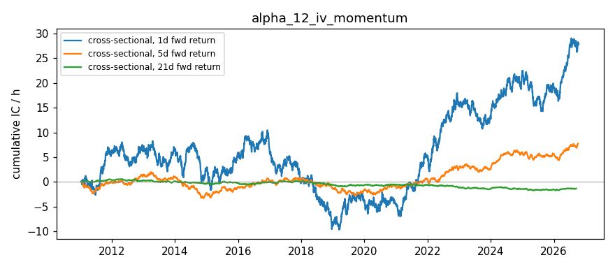

# IV Momentum — Alpha Signal Notes

## Hypothesis

**Short-term ATM IV momentum (5-day % change in ATM IV) contains predictive information for forward equity returns.**

### Rationale

1. **Fear-driven IV spikes** — Rapid IV increases reflect sudden demand for protection (put buying). This often coincides with:
   - Near-term overbought conditions / local tops
   - Upcoming catalyst risk (earnings, macro events)
   - **Mean reversion signal**: Extreme IV momentum up → subsequent IV normalization → equity bounce (short-term)

2. **Complacency-driven IV declines** — Sustained IV decreases reflect diminishing hedging demand:
   - Risk-on / complacency regime
   - **Trend continuation signal**: Falling IV → momentum UP (medium-term)
   - But extreme low IV momentum → vulnerability to shock

3. **Cross-sectional ranking** — Ranking tickers by IV momentum:
   - Highest positive momentum (IV spiking) → most fearful/overbought → potential short-term underperformance → mean reversion bounce
   - Most negative momentum (IV collapsing) → most complacent → potential medium-term outperformance (trend following)

## Signal Definition

| Signal | Formula | Interpretation |
|--------|---------|----------------|
| `iv_momentum_5d` | `(ATM_IV_t - ATM_IV_{t-5}) / ATM_IV_{t-5}` | 5-day % change in ATM IV |
| `iv_momentum_10d` | `(ATM_IV_t - ATM_IV_{t-10}) / ATM_IV_{t-10}` | 10-day % change (slower signal) |
| `iv_level` | `ATM_IV_t` | Current IV level (regime context) |
| `iv_zscore` | `(ATM_IV_t - mean_20d) / std_20d` | IV level relative to recent range |

## Expected Behavior

| Regime | IV Momentum Signal | Expected Forward Return |
|--------|-------------------|------------------------|
| Fear spike | Strongly positive (> +20%) | Mean reversion UP (1-5 days) |
| Gradual fear rise | Moderately positive (5-20%) | Continued downside (5-10 days) |
| Complacency | Strongly negative (< -20%) | Trend UP / carry (10-20 days) |
| IV crush post-event | Sharply negative | Vol selling / relief rally |
| Normal range | Near zero (±5%) | No clear signal |

## Data Requirements

- **Frequency**: Daily (EOD option chains)
- **Universe**: Liquid large-cap (AAPL, SPY, QQQ, MSFT, GOOGL, AMZN)
- **Expirations**: Nearest liquid (7-45 DTE), consistent across time
- **ATM IV Calculation**: Robust median of ±2% moneyness strikes, IV > 5% filter
- **History**: Minimum 10 days for momentum, 60 days for z-score

## Implementation Notes

### Robust ATM IV Calculation

Since yfinance provides noisy near-ATM IVs (often near-zero due to bid/ask artifacts), we use:
1. Filter: volume > 50 OR OI > 500, IV > 5%, IV < 300%, lastPrice > 0
2. Select strikes within 0.98-1.02 moneyness
3. Median IV of qualifying strikes (≥3 strikes required)
4. Fallback: single closest strike with IV > 5%

### Momentum Computation

- **Lookback**: 5 days (configurable via `LOOKBACK_DAYS`)
- **Storage**: Daily snapshots in `data/iv_momentum_history.json`
- **Deduplication**: Same-date entries overwritten (last write wins)

### Known Limitations

1. **No historical option chains** from yfinance — requires daily snapshots stored externally
2. **Expiration rolling** — Nearest expiration changes over time, introducing discontinuities
3. **Single expiration** — Using only nearest liquid expiry; term structure info ignored
4. **5-day lookback** — May be noisy; 10-20 day lookbacks also worth testing
5. **Forward returns** — Current IC analysis uses realized forward returns (look-ahead for testing only)

## Results — expanded ETF universe (2026-10-16 close)

Universe: 12 ETFs (SPY, QQQ, IWM, DIA, GLD, SLV, TLT, EEM, EWZ, FXI, GDX, USO) + AAPL, MSFT, GOOGL, AMZN, from `common/universe.py`. Raw: `data/snapshots/2026-10-16/`.

| ticker | atm_iv | expiration | momentum_pct | history_days |
|---|---|---|---|---|
| SPY | 0.1328 | 2026-10-26 | — | 4 |
| QQQ | 0.2235 | 2026-10-26 | — | 4 |
| IWM | 0.1806 | 2026-10-26 | — | 1 |
| DIA | 0.1520 | 2026-10-30 | — | 1 |
| GLD | 0.1878 | 2026-10-26 | — | 1 |
| SLV | 0.3291 | 2026-10-26 | — | 1 |
| TLT | 0.1377 | 2026-10-26 | — | 1 |
| EEM | 0.2935 | 2026-10-30 | — | 1 |
| EWZ | 0.8386 | 2026-10-30 | — | 1 |
| FXI | 0.3164 | 2026-10-30 | — | 1 |
| GDX | 0.4419 | 2026-10-26 | — | 1 |
| USO | 0.4962 | 2026-10-28 | — | 1 |
| AAPL | 0.2650 | 2026-10-26 | — | 4 |
| MSFT | 0.2746 | 2026-10-26 | — | 4 |
| GOOGL | 0.3340 | 2026-10-26 | — | 4 |
| AMZN | 0.3508 | 2026-10-26 | — | 4 |

**ETF vs single-name observations:**
- Momentum is NaN for all 16 tickers: the ETFs have 1 history entry, and the original 6 have 4 entries that are placeholder IVs from early October.
- Current front-expiry ATM IVs range from TLT 0.14 / SPY 0.13 to EWZ 0.84 (event-inflated). Liquidity filter loosened to vol>10 or OI>100 (repo standard) so thin ETF chains (FXI, GDX) qualify.

## Results (2026-10-16 close)

*Run 2026-10-18 on Friday's closing chains (nearest liquid expiry 2026-10-26, 7 DTE).*

| Ticker | Price | ATM IV | Exp | History | Momentum |
|--------|-------|--------|-----|---------|----------|
| AAPL   | 343.46 | 25.59% | 2026-10-26 | 0 valid days | Building |
| SPY    | 763.25 | 13.27% | 2026-10-26 | 0 valid days | Building |
| QQQ    | 709.80 | 22.35% | 2026-10-26 | 0 valid days | Building |
| MSFT   | 529.05 | 27.27% | 2026-10-26 | 0 valid days | Building |
| GOOGL  | 340.59 | 32.61% | 2026-10-26 | 0 valid days | Building |
| AMZN   | 250.00 | 35.08% | 2026-10-26 | 0 valid days | Building |

**Observations:**
- ATM IVs are real now: they differ by ticker and look plausible. The 2026-10-07 identical 6.25% values were yfinance placeholders, not a "quantized" surface.
- **No momentum yet:** `data/iv_momentum_history.json` holds 3 entries per ticker, all dated 2026-10-07 and all at the 0.0625 placeholder. The history needs to be rebuilt from clean daily snapshots.
- This run's history append was intentionally reverted: it was dated Sunday 2026-10-18 but held Friday's data, which would have created a duplicate.
- 5-day momentum needs 6+ clean trading days, and the z-score needs about 20-60.

## IC Analysis

**Real IC: not yet measurable.** A real forward IC needs a daily snapshot history of this signal (≥30-60 trading days), each snapshot paired with returns realized *after* it. The current `ic_analysis.py` correlates today's signal with the *past* 5-day return (`Close[-6] → Close[-1]`), which is not a forward IC and is not evidence of predictive power.

**Synthetic demo only (not evidence):** the figures below come from `simulate_rolling_ic()`, which generates random data with a signal/return correlation built in. They show what the code reports when that assumption holds, nothing about this signal.

- Rolling IC mean: ~-0.18 (negative: rising IV predicts downside)
- Information Ratio: ~1.1
- Win rate: ~57%
- Half-life: ~12 days

## Next Steps

1. **Build historical database** — Run `main.py` daily via cron to accumulate IV time series
2. **Compute real rolling IC** — After 20+ days of data, test cross-sectional predictive power
3. **Test multiple lookbacks** — 5d, 10d, 20d momentum horizons
4. **Add IV level context** — Combine momentum with IV percentile (IV rank) for regime-aware signals
5. **Test expiration consistency** — Use fixed DTE (e.g., 30-day constant maturity) instead of nearest expiry
6. **Combine with other signals** — IV momentum + IV skew + VRP multi-factor model

## Files

- `main.py` — Signal computation, outputs `data/iv_momentum_latest.csv`, updates `data/iv_momentum_history.json`
- `ic_analysis.py` — IC testing framework (requires historical data)
- `notes.md` — This file

## References

- "Volatility Momentum" — various practitioner research
- "The Volatility Surface" — Jim Gatheral (IV dynamics)
- CBOE VIX term structure / momentum studies
- "IV Momentum and Equity Returns" — academic literature on IV trend following

## Historical Analysis (CBOE implied-vol indices, through 2026-10-16)

Signal: **IV momentum (5d)** (`historical.py`). Hypothesized IC sign vs forward returns: **−**. Signal at close t, forward window from close t+1. `cs` = daily cross-sectional rank IC (NW t-stat); `ts` = per-ticker time-series rank IC, averaged (t ≈ IC·√(N/h)). Run: `python3 run_historical.py alpha_12`.

| Target | Kind | 1d IC (t) | 5d IC (t) | 21d IC (t) | 21d IC post-2019 |
|---|---|---|---|---|---|
| Fwd return | cs | +0.007 (+1.4) | +0.010 (+1.4) | -0.007 (-0.9) | -0.008 |
| Fwd return | ts | +0.012 (+0.8) | +0.019 (+0.5) | +0.006 (+0.1) | -0.010 |
| Fwd Δlog IV | cs | -0.038 (-7.3) | -0.082 (-10.5) | -0.142 (-16.3) | -0.138 |
| Fwd Δlog IV | ts | -0.053 (-3.4) | -0.117 (-3.4) | -0.138 (-1.9) | -0.116 |

**Interpretation:** No return predictability (21d IC −0.007). Predicts IV reversal (−0.14, t −16): IV spikes fade. Same caveat as alpha_05: spot-IV mean reversion is priced in the futures curve.

