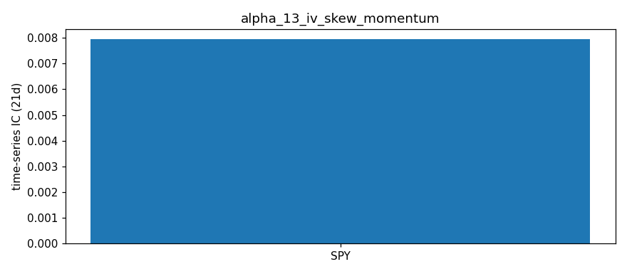

# IV Skew Momentum — Alpha Signal Notes

## Hypothesis

**Core idea**: The *rate of change* of put-call IV skew (25-delta) contains predictive information beyond the skew level itself.

- **Skew steepening** (momentum > 0): Accelerating put buying / call selling → rising fear, hedging demand, or informed downside positioning. May precede:
  - Continued downside (momentum persistence)
  - Mean-reversion bounce (overbought fear)
  
- **Skew flattening** (momentum < 0): Complacency, call buying, put selling → low fear premium. May precede:
  - Continued upside (complacency persistence)
  - Sudden skew steepening event (vol event risk)

## Signal Construction

1. **Universe**: AAPL, SPY, QQQ, MSFT, GOOGL, AMZN (liquid, diverse sectors)
2. **Skew measure**: 25-delta put IV - 25-delta call IV (approximated via 0.95/1.05 moneyness)
3. **Expiration**: Nearest liquid (7-45 DTE) to capture near-term sentiment
4. **Momentum**: (Current skew - Skew 5 days ago) / 5 — daily rate of change
5. **Regime filters**: 
   - Skew z-score (current vs 20-day history) — extreme levels may mean-revert
   - Skew volatility (20-day std) — high vol = noisy signal

## Expected Decay Horizon

- **Short-term (1-5 days)**: Momentum persistence — fear/complacency tends to cluster
- **Medium-term (5-20 days)**: Mean-reversion — extreme skew changes often overshoot
- **Long-term (>20 days)**: No predictive power — skew level matters more than change

## Cross-Sectional Approach

Rank tickers by skew momentum each day:
- **Long**: Most negative momentum (skew flattening fastest → complacency → potential vol event)
- **Short**: Most positive momentum (skew steepening fastest → fear peaking)
- **Neutral**: Middle quintiles

Alternative: Sort by skew z-score for mean-reversion (long extreme negative z, short extreme positive z).

## Risk Factors

1. **Earnings/events**: Skew naturally steepens pre-earnings — must filter or adjust
2. **Expiration rolling**: DTE changes affect skew level — use constant-maturity or DTE-matched
3. **Liquidity**: 25-delta approximation breaks down in illiquid names
4. **Regime shifts**: 2020/2022 regime changes alter skew baseline

## Data Requirements

- Daily skew snapshots (run main.py daily via cron)
- Minimum 20 days for momentum calculation
- 60+ days for rolling IC analysis
- Forward returns: 1-day, 5-day, 10-day horizons

## Testing Plan

1. **Accumulate history**: Run daily for 60+ trading days
2. **Compute IC**: Cross-sectional Spearman rank IC vs 1d/5d/10d forward returns
3. **Rolling IC**: 60-day window to assess stability
4. **Signal metrics**: IR, win rate, half-life, max drawdown
5. **Regime analysis**: IC conditioned on VIX level, market trend
6. **Look-ahead check**: Ensure no future data leakage in skew calculation

## Relationship to Existing Signals

| Signal | Folder | Relationship |
|--------|--------|--------------|
| IV Skew Dynamics (level) | alpha_02 | This is the *level*; momentum is the *derivative* |
| IV Term Structure | alpha_03 | Skew term structure vs skew momentum |
| VRP | alpha_04 | VRP = IV² - RV²; skew momentum captures IV asymmetry change |
| IV Momentum | alpha_12 | ATM IV trend vs skew (OTM) trend |

## Implementation Notes

- Uses JSON history file (`data/iv_skew_momentum_history.json`) for persistence
- Approximates 25-delta via fixed moneyness (0.95/1.05) — could improve with delta calc
- Filters: volume > 10 or OI > 100 per leg, min 5 contracts each side
- Cron-friendly: single run fetches all tickers, updates history, outputs signals

## Results — expanded ETF universe (2026-10-16 close)

Universe: 12 ETFs (SPY, QQQ, IWM, DIA, GLD, SLV, TLT, EEM, EWZ, FXI, GDX, USO) + AAPL, MSFT, GOOGL, AMZN, from `common/universe.py`. Raw: `data/snapshots/2026-10-16/`.

| ticker | dte | put_25d_iv | call_25d_iv | skew_25d |
|---|---|---|---|---|
| SPY | 7 | 0.2394 | 0.1201 | 0.1193 |
| QQQ | 7 | 0.3102 | 0.1868 | 0.1234 |
| IWM | 7 | 0.2583 | 0.1680 | 0.0903 |
| DIA | 11 | 0.2085 | 0.1414 | 0.0671 |
| GLD | 7 | 0.2044 | 0.1939 | 0.0105 |
| SLV | 7 | 0.3672 | 0.3164 | 0.0508 |
| TLT | 7 | 0.1816 | 0.1777 | 0.0039 |
| EEM | 11 | 0.3140 | 0.2813 | 0.0327 |
| EWZ | 11 | 0.8857 | 0.7617 | 0.1240 |
| FXI | 11 | 0.2578 | 0.3281 | -0.0703 |
| GDX | 11 | 0.4761 | 0.4556 | 0.0205 |
| USO | 9 | 0.4829 | 0.5217 | -0.0388 |
| AAPL | 7 | 0.3023 | 0.2327 | 0.0696 |
| MSFT | 7 | 0.3145 | 0.2651 | 0.0493 |
| GOOGL | 7 | 0.3308 | 0.3042 | 0.0266 |
| AMZN | 7 | 0.3485 | 0.2859 | 0.0626 |

**ETF vs single-name observations:**
- Skew level only (momentum needs ≥5 days of history). Index ETFs have the steepest 25Δ skew at 7–11 DTE (QQQ 12.3, SPY 11.9, EWZ 12.4 vol pts); FXI (−7.0) and USO (−3.9) show call skew.
- Expiry selection now falls through to the next 7–45 DTE expiry when the nearest one has <5 liquid puts/calls (fixes GDX).

## Next Steps

1. ✅ Create main.py, ic_analysis.py, notes.md
2. 🔄 Run daily via cron to accumulate history
3. ⏳ After 30 days: run IC analysis, document results
4. ⏳ Test regime conditioning (VIX > 20 vs < 20)
5. ⏳ Compare with alpha_02 (skew level) — does momentum add orthogonal info?

## Historical Analysis (CBOE implied-vol indices, through 2026-10-16)

Signal: **SPX skew momentum (ΔSKEW 5d)** (`historical.py`). Hypothesized IC sign vs forward returns: **−**. Signal at close t, forward window from close t+1. `cs` = daily cross-sectional rank IC (NW t-stat); `ts` = per-ticker time-series rank IC, averaged (t ≈ IC·√(N/h)). Run: `python3 run_historical.py alpha_13`.

| Target | Kind | 1d IC (t) | 5d IC (t) | 21d IC (t) | 21d IC post-2019 |
|---|---|---|---|---|---|
| Fwd return | ts | -0.004 (-0.3) | +0.017 (+0.6) | +0.008 (+0.1) | +0.015 |
| Fwd Δlog IV | ts | +0.010 (+0.8) | -0.002 (-0.0) | +0.018 (+0.3) | +0.011 |

**Interpretation:** No predictability for SPY returns or VIX changes at any horizon. Hypothesis not supported.

