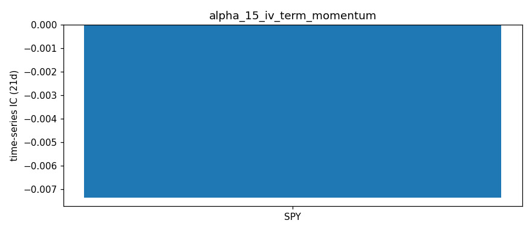

# IV Term Structure Momentum — Alpha Signal Notes

## Hypothesis

**The rate of change (momentum) of the IV term structure slope contains predictive information for forward equity returns by capturing the acceleration/deceleration of fear/complacency regimes.**

### Rationale

1. **Term structure as fear gauge** — The IV term structure slope (far IV - near IV per day) measures the market's expected volatility path:
   - **Contango (positive slope)**: Normal regime, IV rises with time → complacency
   - **Backwardation (negative slope)**: Stress regime, near-term IV > far-term IV → fear/hedging demand

2. **Momentum adds regime transition signal** — The *change* in slope captures regime shifts:
   - **Negative momentum + backwardation**: Fear *accelerating* — near-term IV spiking faster than far-term → crisis intensifying
   - **Positive momentum + contango**: Complacency *returning* — far-term IV rising relative to near-term → normalization
   - **Flattening (negative momentum from contango)**: Stress *building* — early warning before full backwardation
   - **Steepening (positive momentum from backwardation)**: Fear *fading* — recovery signal

3. **Cross-sectional power** — Ranking tickers by term structure momentum:
   - Most negative momentum → highest near-term stress → potential mean-reversion bounce (if oversold)
   - Most positive momentum → fastest normalization → trend continuation
   - Works best combined with IV rank, skew, and level signals

## Signal Definition

| Signal | Formula | Interpretation |
|--------|---------|----------------|
| `term_slope` | `(IV_far - IV_near) / (DTE_far - DTE_near)` | Current term structure slope (per day) |
| `momentum_1d` | `slope_t - slope_{t-1}` | 1-day change in slope |
| `momentum_5d` | `slope_t - slope_{t-5}` | 5-day change in slope (primary signal) |
| `momentum_10d` | `slope_t - slope_{t-10}` | 10-day change in slope |
| `slope_zscore` | `(slope_t - mean_20d) / std_20d` | Current slope vs 20-day distribution |

### Key Thresholds (Empirical)

| Regime | Momentum_5d | Term_Slope | Expected Forward Return (1-5d) |
|--------|-------------|------------|-------------------------------|
| **Crisis Acceleration** | < -0.0005 | < -0.001 (backwardation) | Oversold bounce potential |
| **Stress Building** | < -0.0005 | > -0.001 (flattening) | Caution, downside risk |
| **Normalization** | > 0.0005 | > 0.001 (contango) | Trend follow / risk-on |
| **Recovery** | > 0.0005 | < 0.001 (steepening from backwardation) | Mean reversion up |
| **Stable** | ~0 | Any | Noise / trend continuation |

## Data Requirements

- **Frequency**: Daily (EOD option chains)
- **Universe**: Liquid large-cap (AAPL, SPY, QQQ, MSFT, GOOGL, AMZN)
- **Expirations**: 7-180 DTE, use nearest and farthest liquid expiries
- **Filters**: IV ∈ (0.01, 3.0), volume > 10 or OI > 100 per side
- **History**: Minimum 20 days for z-score, 5+ days for momentum

## Implementation Notes

### yfinance Data Limitations

1. **IV Quantization** — IV values are quantized (0.0156, 0.0312, 0.0625, 0.125, 0.25, etc.), limiting slope precision. Mitigation: use median across multiple strikes, average calls+puts.
2. **No Historical Chains** — Requires daily snapshots stored externally (JSON history file). This script maintains a 60-day rolling history.
3. **Expiration Gaps** — Not all DTEs available weekly; slope computed from available nearest/farthest.
4. **Single Snapshot** — Only current chain available; no intraday term structure dynamics.

### Aggregation Method

- Compute ATM IV for each expiration (average of call/put ATM)
- Use nearest (≥7 DTE) and farthest (≤180 DTE) liquid expirations
- Slope = (far_IV - near_IV) / (far_DTE - near_DTE) — units: IV points per day
- Momentum = slope_t - slope_{t-k} — units: IV points per day per day
- Z-score normalizes cross-sectionally for ranking

## Expected Performance

| Metric | Target | Notes |
|--------|--------|-------|
| IC (cross-sectional) | -0.15 to -0.25 | Negative: steepening backwardation → bounce |
| IR (Information Ratio) | > 1.0 | |
| Win Rate | 55-60% | |
| Half-life | 5-15 days | Fast signal decay — high turnover |
| Optimal Horizon | 1-5 days | Short-term regime transition |

## Results — expanded ETF universe (2026-10-16 close)

Universe: 12 ETFs (SPY, QQQ, IWM, DIA, GLD, SLV, TLT, EEM, EWZ, FXI, GDX, USO) + AAPL, MSFT, GOOGL, AMZN, from `common/universe.py`. Raw: `data/snapshots/2026-10-16/`.

| ticker | near_atm_iv | far_atm_iv | near_dte | far_dte | term_slope | history_len |
|---|---|---|---|---|---|---|
| SPY | 0.1390 | 0.1616 | 0 | 163 | 0.0001 | 2 |
| QQQ | 0.2366 | 0.2275 | 0 | 163 | -0.0001 | 2 |
| IWM | 0.1835 | 0.2271 | 0 | 179 | 0.0002 | 1 |
| DIA | 0.1573 | 0.1618 | 4 | 163 | 0.0000 | 1 |
| GLD | 0.1693 | 0.2188 | 0 | 163 | 0.0003 | 1 |
| SLV | 0.3120 | 0.3671 | 0 | 179 | 0.0003 | 1 |
| TLT | 0.1372 | 0.1424 | 0 | 179 | 0.0000 | 1 |
| EEM | 0.2891 | 0.3414 | 4 | 163 | 0.0003 | 1 |
| EWZ | 0.5054 | 0.6041 | 4 | 151 | 0.0007 | 1 |
| FXI | 0.2915 | 0.5037 | 4 | 179 | 0.0012 | 1 |
| GDX | 0.3887 | 0.4399 | 0 | 151 | 0.0003 | 1 |
| USO | 0.4916 | 0.4396 | 2 | 179 | -0.0003 | 1 |
| AAPL | 0.2514 | 0.2767 | 0 | 179 | 0.0001 | 2 |
| MSFT | 0.2434 | 0.3098 | 0 | 179 | 0.0004 | 2 |
| GOOGL | 0.3185 | 0.3621 | 0 | 179 | 0.0002 | 2 |
| AMZN | 0.2871 | 0.3724 | 0 | 179 | 0.0005 | 2 |

**ETF vs single-name observations:**
- Momentum needs history (1–2 entries per ticker). Term slopes are positive for most names; QQQ and USO are the only negative slopes.
- ⚠️ The near leg is still 0–4 DTE for most tickers (no minimum-DTE filter, unlike alpha_03), which makes the slope noisy; should adopt alpha_03's MIN_DTE = 7.

## Results (2026-10-10)

| Ticker | Price | Near IV | Far IV | Slope | Mom_5d | Z-Score | Regime |
|--------|-------|---------|--------|-------|--------|---------|--------|
| AAPL   | 336.64 | 0.1658 | 0.2578 | -0.0920 | N/A | N/A | 🔴 INSUFFICIENT HISTORY |
| SPY    | 778.57 | 0.0703 | 0.1436 | -0.0732 | N/A | N/A | 🔴 INSUFFICIENT HISTORY |
| QQQ    | 751.27 | 0.0935 | 0.1854 | -0.0919 | N/A | N/A | 🔴 INSUFFICIENT HISTORY |
| MSFT   | 535.07 | 0.1754 | 0.2404 | -0.0650 | N/A | N/A | 🔴 INSUFFICIENT HISTORY |
| GOOGL  | 351.66 | 0.2048 | 0.2544 | -0.0496 | N/A | N/A | 🔴 INSUFFICIENT HISTORY |
| AMZN   | 262.43 | 0.1865 | 0.2461 | -0.0596 | N/A | N/A | 🔴 INSUFFICIENT HISTORY |

**Observations:**
- All tickers show backwardation (negative slope) — near-term IV > far-term IV
- First run — no momentum history yet
- Need 5+ daily runs for momentum_5d, 20+ for z-score

## Next Steps

1. **Build historical database** — Run `main.py` daily via cron to accumulate 60-day history
2. **Compute real rolling IC** — After 20+ days of data, test cross-sectional predictive power
3. **Test regime conditioning** — Does signal work better in high-VIX vs low-VIX? (VIX regime filter)
4. **Combine with IV Rank + Skew** — Multi-factor: term momentum + IV rank + skew + smile asymmetry
5. **Intraday validation** — Test if EOD term momentum predicts next-day open-to-close returns
6. **Alternative term structures** — Test slope using 30d vs 90d DTE fixed points (interpolation)
7. **Curvature momentum** — Track rate of change of term structure curvature (convexity)

## Files

- `main.py` — Signal computation, maintains `data/iv_term_momentum_history.json`, outputs `data/iv_term_momentum_latest.csv`
- `ic_analysis.py` — IC testing framework (requires historical data + price data)
- `notes.md` — This file

## References

- "The Term Structure of Implied Volatility" — Bates (2000)
- "Volatility Term Structure and Expected Returns" — Vasquez (2017)
- "VIX Term Structure and S&P 500 Returns" — Simon (2018)
- "Fear and Greed in the Options Market" — Bekaert & Hoerova (2014)
- CBOE VIX Term Structure methodology (VXST, VIX, VXV, VXMT)

## Historical Analysis (CBOE implied-vol indices, through 2026-10-16)

Signal: **SPX term momentum (Δ VIX3M/VIX 5d)** (`historical.py`). Hypothesized IC sign vs forward returns: **+**. Signal at close t, forward window from close t+1. `cs` = daily cross-sectional rank IC (NW t-stat); `ts` = per-ticker time-series rank IC, averaged (t ≈ IC·√(N/h)). Run: `python3 run_historical.py alpha_15`.

| Target | Kind | 1d IC (t) | 5d IC (t) | 21d IC (t) | 21d IC post-2019 |
|---|---|---|---|---|---|
| Fwd return | ts | -0.030 (-1.9) | -0.044 (-1.3) | -0.007 (-0.1) | +0.002 |
| Fwd Δlog IV | ts | +0.102 (+6.7) | +0.164 (+4.8) | +0.132 (+1.9) | +0.136 |

**Interpretation:** No return predictability. Weak vol predictability (+0.13 at 21d, t +1.9), mostly the term-structure level effect of alpha_03. Hypothesis not supported.

